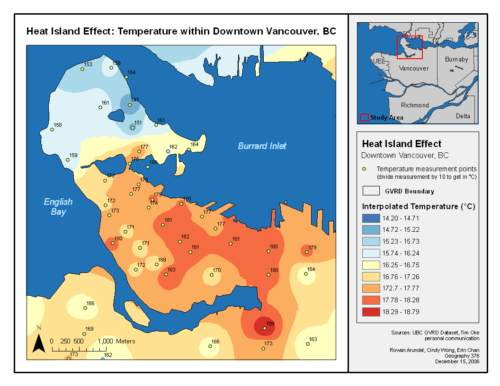

# Urban Area

## Vancouver, Canada

  - **Location:** Canada’s 3rd largest city, West Coast,
    backed by mountains, Fraser River cuts through.

  - **Temperature**
    
      - **Cool Areas:** Stanley Park, Fraser River, Fraser Valley
        farmland.
    
      - **Warm Areas:** airport, Urban Heat Island dome occurs where
        there is greatest building and skyscraper concentration.
    
      - **+10°C warmer** CBD compared to southern rural area (27°C vs
        17°C).
    
      - Greatest difference on calm, cloudless, anti-cyclonic summer
        nights. No winds = no heat removed.

  - **Humidity:** humid spots over Burrard Inlet and Fraser River, and
    higher humidity at night because moisture is deposited rurally.
    Perceived humidity is 2% less than Richmond.

  - **Precipitation:** each 100m height gain results in 100mm
    precipitation increase. Vancouver is 10% cloudier than rural areas –
    because buildings force convection, there are more condensation
    nuclei present, storm cells intensify due to warm surface. 1 inch
    more rainfall in winter average than Richmond. Consistently higher
    daily percentage chance of precipitation too: 1% average.

  - **Winds:** tall buildings scatter and reduce winds, ‘wind corridors’
    exist where two buildings cause the venturi effect (air forced into
    a smaller space speeds up). Downtown winds are 6.6mph average in
    winter, and 7.1mph in Richmond – just south of CBD. In spring/summer
    difference is around 0.3mph.

  - **Fog/Smog:** Fraser Valley experiences photochemical smog on warm
    summer days due to more ozone concentration. Calm winds, stagnant
    air and greater hygroscopic nuclei along with anticyclones causing a
    subsidence temperature inversion promotes fog/smog creation. 75% of
    pollution is from vehicles, 7x number of particulates, 200x number
    of gaseous pollutants compared to rural areas.

