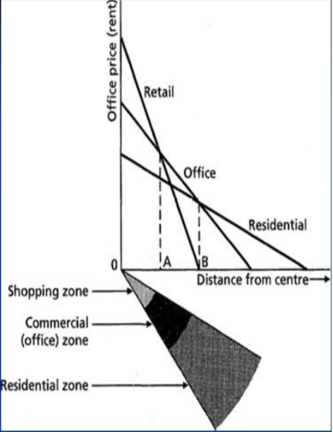
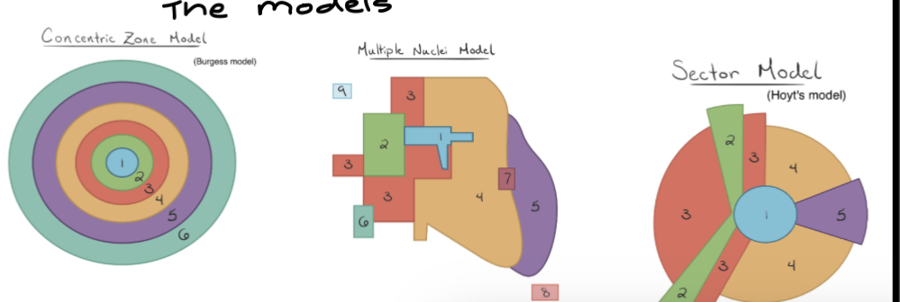

## **Auckland, NZ-Urban Settlement**

### **Functions of Auckland CBD**

* Centre of commercial
  * Majority of activity takes place in the centre
    * Has 500 shops and is on 250 K Road
* Entertainment + cultural centre
  * Auckland Museum and Aotea Square
* Educational centre
  * Centre of city contains Auckland Uni and AUT
  * Flatting student dorms are also provided near Britomart Hub
* Recreational parks
  * Victoria + Albert Park
* Light industry
  * Areas of light industry located around the wharf
* Hotel + accomodation
  * Major area
* Residential 
  * Home to over 4000 people
  * 2500 apartments

### **Models influencing the urban structure**

**Bid Rent Theory**

* Basic theory: distance to CBD  is dependent on how much people are willing to pay
  * Urban land uses have different demands thus attract different competition
  * General trend: financial areas tend to be closer to the cbd (banking), retailing and industry tend to be 2nd and 3rd away from cbd, housing is the furthest
  * Reason for trends: desirability to be close to cbd has decreased by housing buyers because of high cost (so they outbid)
  * This is because cost for cbd settlement is high and it is costly to rent in cbd esp. for apartment
  * Whereas industry: they need flat land for industry (to establish factories etc)
  * Banks, commercial, etc. are willing to pay the most to rent in the cbd (eg: ANZ is located in cbd)→high rise building is needed to maximise land and locate in the periphery in newmarket and some high order sectors willing to pay a high price (to ensure highest growth)

     
* **__Sector Model__**
  * Most people have access to cbd
  * Industry follow most attractive
  * Low class forced in less attractive areas and path pollution blown (link to housing market)
  * **Clevedon**
    * **r**eurbanised area located outside commuter zone
    * Growth of services occurring as a result of people migrating outside of Auckland (more customers)
  * **Onehaunga**
    * unable to afford statehousing and are forced in pollution blown areas where industry work
  * **Remuera/Mt Eden**
    * high class residential away from state housing
    * people with high incomes can afford
    * resulting in residential segregation
* **__Functional Zones__**
  * Remuera/Mt Eden tend to be located away from industrial areas, away from pollution
    * Typically are high cost settlement areas near coastal/sea areas
    * Leads to residential segregation: only people with high earning jobs such as doctors or engineers usually live in these areas whereas people living in onehaunga or rosebank usually have more lower paying jobs in industry (leading to the creation of state housing)
  * Commercial activities want to be in cbd from accessibility
  * Certain activities group together and benefit from cohesion:
    * **retail, commercial and industry**⇒industry can produce materials for commercial,
    * Also they can get more **business, retail and commercial** together=more customers visiting shops=more money
      * Example: Sylvia Park in Mt Wellington (clothing stores-H&M, cinemas-Hoyts, retail stores such as Warehouse are grouped together)
  * Cost: warehousing=large cheap sites and low rent areas: second hand clothing shops and furniture shops
  * State housing is provided in **onehaunga and rosebank** for people who are unable to afford expensive housing
    * often acting as a "buffer" between industrial and residential functional zone
    * often in the path of pollution

  **__Multiple nuclei__**
* **What it is**
  * Low class housing around industry: state class housing surrounds onehaunga/otahuhu, it's easier for people working in industry to go to work
  * Housing tends to settle around new nuclei-eg: sylvia park since it is located in centre, many houses settle around mt wellington or howick/botany, many of houses settle around botany town centre
  * Higher class avoid industrial land
* **Examples in Auckland:**
  * **Manukau City**
    * Acting as a secondary growth that was established when the government was developing Auckland
    * Admin commercial/industrial growth area
    * Used to reduce congestion within the cbd
  * **Albany Shore**
    * Establishing industry
    * North Shore contain 50% of employees
    * Industrial area was established because there was flat land and agglomeration
    * There was also good transport networks
  * **Queen Street**
    * Located in CBD
    * Queen street established as centre due to historical factors
      * Earlier on, there was a tramway established at Queen Street at 1901
      * This was eventually demolished for Britomart Transport hub
      * The establishment of this tramway also allowed for the establishment of Epsom (another nuclei) as an urban area-previously, it was a rural area
        * Epsom also is established as a place of development (it has school’s such as Epsom Girl’s Grammar, restaurants, shops etc)
    * Even now, it is still established as a centre of development + it has restaurants, shops etc
  * **Viaduct**
    * Established as a centre of Auckland via. gentrification
      * reason: America’s Cup + needed a venue to establish to cope with large amount of population for America’s Cup
      * Now part of the centre of the city + contains services such as restaurants etc
    * **Gentrification + how it has changed Auckland**
      * Inner city suburbs have become younger (young couples, professionals and young families reside in Auckland)
      * There is a change in ethnicity from PI and Maori to European
      * Population density has fallen due to smaller families
      * Change in house prices
      * Increase in rates
      * Increase in median income
      * More retail and commercial businesses reflects increased incomes of new residences
      * Houses have been renovated, restored and painted
      * Area looks better, trees planted and gardens are landscaped, streets restarsealed and narrowed so traffic can be slowed don
      * Different income group→higher social + economic groups
      * Residents more politically aware and City Council aware of suburbs need’s + issues
* **__The housing market in Auckland (Akl)__**
  * Housing prices in Akl are high \~$1,000,000 (due to the housing crisis and shortage of housing in auckland for the growing population)
  * Less people want to settle in Akl because they are no longer able to afford it
  * Also people want to move to other places outside of Auckland with cheaper prices⇒may be liked to counter urbanisation (people moving out from clevedon)
  * People might want to move away from CBD because it's more expensive and want to move to suburbs

    \

  **__Hoyts model__**
* **__What it is__**
* __This model is based off the fact that concentric development sectors can afford the best routes for the delivery of supply__
* Modification of concentric development

**Examples**:

* **Albany**
  * Originally industry but change to commercial zone
  * Flat land, agglomeration (there were other industries established + they wanted to cluster that can attract a large amount of customers) + there were also other factors that came into play
* **Otahuhu**
  * Is an industry zone (partially)
  * also **Britomart transport hub** allows for transport between Otahuhu + other parts of Auckland
    * Britomart + Vector Arena is **formed by urban renewal which has**
      * Attracted more businesses + employers into city + basin
      * Attracted shops
      * Attracted people to live in the city
      * Improved physical + human environment
    * **How did urban renewal take place?**
      * 1990’s→ACC (Auckland City Council tries to reverse decline process through redevelopment of Viaduct + developed a plan to change land use of wharfs, ports, industrial land + warehouses
* **Onehaunga or Rosebank**
  * established near northwest motorway
  * providing railway to Otahuhu train station

     

### **Other factors influencing urban structure**

* **Historical factors:**
  * WW2-Auckland develops
    * Rosebud Road in Wellington is being developed
  * Motorway development=South and Northwest highway is more accessible and there is more suburban development
  * ARC made a division for growth on the outer suburbs
  * Tram systems (1901) are built around Queen Street or are near Queen Street (typically the main or favoured area), eventually demolished for a Britomart hub
  * Establishes Epsom as an urban area (prior to this it was a rural area)

  **Economic factors:**
* Desirability
  * Bid rent model (refer to answer)
  * High residential areas
  * Remuera, Mt Eden are located away from state housing and acts as a “buffer” between urban areas and industry
* **Access**
* Centrality-centre for a large amount of attraction for customers
  * Profitable and is the only place it can locate at
* **Transport**
  * Ring node around Queen Street,
  * nodal structure,
  * No ring roads
  * Easy for customers to access
  * Remuera and Queen Street has a high amount of access
  * Great South Road, motorway and Auckland transport
  * Remuera and Queen Street have a high amount of access

**Agglomeration**

* Similar land uses are clustered together
* Retail is with retail →eg: Sylvia Park
* Industry →East Tamaki are near transport routes
* **Political factors:**
* Decentralisation: need more space + area for the expanding population
  * 1950-1960 best access to port, rail
  * Includes cheap sites
* Access to a large amount of labour, pool and motorway access
* **Proximity**
  * Uni students rely on transport + move in to cut down on travelling
  * Centrality especially for retails
  * Centre attracts a large amount of customers and profitable=the only place that can locate there

