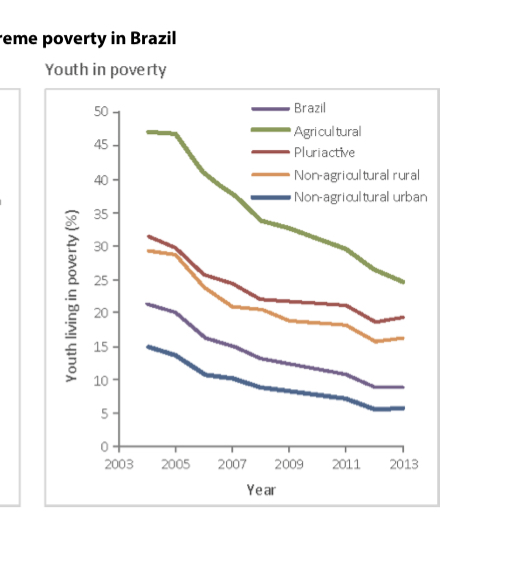
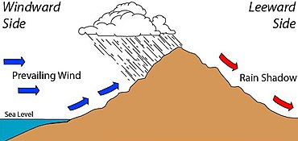

## **Rural Urban Migration (Rural NE, Urban NE, Sao Paulo)**

**General Pattern**

* 10m people from 1960-2001
* ne to se 4m 1960-2001 s to se
* follows a pattern of chain migration and distance decay (usually in short distances)

  **Sao Paulo-Impacts**
* 65% **urban growth**
  * due to a high population and amt of migrants entering competition for space
  * high amount of population=more dense living in order to fit more housing in resulting in growth of favelas
  * also too little space=high amount of people=over population, poor living standards,
* Housing is **substandard**
  * In Sao Paulo corticos take up
    * 25% favela
    * 15% health problem:  cholera is a major health problem
  * Also there is poor hygiene due to housing having a lack of sewage, running water, public services
  * High IMR 53/1000 + there is high IMF 7/1000
    * As a result health has deteriorated
* **High crime rates:**
  * high amount of gangs 900 thefts per day, 5500 murders, 360 bank robberies in 1998 highly unregulated so more possibility for robberies etc. people often partake in robberies in order to get necessities illegally and also cheaply as well (eg: food/water)
* **High growth of work/cumulative causation**
  * Brazil has 70% of labour in Sao Paulo, 300 000 migrants per year, over 300 000 businesses , this attracts investment, more migrants and industry, promoting growth in other industries, sao paulo has pop over 24m
  * **Sao Paulo has a high GDP** resulting from mainly industry,
    * 744 million economically prosperous area
      * these areas are getting the best talent from work
      * meaning that in the urban NE there is a higher amount of jobs taken up

        **Urban NE economy: agriculture (not subsistence but commercial) will lead to an increase in jobs that have high demand especially because they may have been left behind ("gaps") as a result of chain migration, mainly for commercial agriculture and people fill in these gaps also industry (but this is not as significant as Sao Paulo)**
        * **More working population and higher wages there is more migration of working pop** from rural ne to ne most of them are migrating for better pay and want to get out of the cycle of poverty
          * this is seen as “last chance”=>they have the mindset that life can’t get any worse than what they have already experienced
        * **Most may decide to take on more tertiary jobs after furthering their education in urban ne** (people decide to migrate to urban ne in order to further education to allow them to pursue better more high paying jobs in sao paulo)
          * Average wages in Rural NE: $4500 + Urban NE: $9000
          * **Higher pressure on education** (and other resources as well) **in rural NE due to the fact there is a high youthful population**
          * **Many people in rural NE, come to over to NE to increase education in order to ensure they have a better chance to get more higher paying degrees**
            * They may bring family as well through remittances and other factors as well
            * **Later on however, increase of workers in schools**=more money needs to be paid for the education cost for education 2000-10000 each year
              * Urban NE: 22% illiterate and there is 30.3% illiterate in rural areas
        * **More traffic/pollution people move to urban areas**, leading to higher wages and more wealth and they **become become more able to afford** **public transport**
          * Higher amount of **public transport** use
            * More congestion and pollution in urban area (4 out of 10 people choose a bus as a form of transport)
          * Eventually, people may be able to afford private transport as well if they carry on working in these areas, leading to even more congestion
        * **Residential segregation**- people may choose to live near the coast of NE and more richer people choose to live away from state housing or favelas in Sao Paulo (which are located close to industry + near the path of pollution)
          * eg: people who are poorer cannot afford to live in high residential areas thus live in **state housing/favelas**
            * Due to the high amount of migration resulting from cumulative causation there is a high amount of people wanting to live in favelas, meaning that there is more competition for space in the favela + people are forced to live in smaller buildings with poorer conditions
            * It also becomes more costly to live in favelas as well (average cost: $700,000 and there is an average monthly income of $724.10 R)
            * Because there is more competition for housing as well shanty town/favelas housing on side of mountains all around brazil often concentrated near affluent communities (easy access to work in the city) made of tin and cinderblock-prone to falling??
            * They have become so built up that it is hard to expand/develop favelas (and install new roading/transport) that are also not catered by govt black market and low living standards (resulting from competition for space)
            * 15% unemployment lead to under employment + 4m burden of people
          * **People who work in admin/clinical jobs or service sector jobs live in more high class residential areas** (such as Rio De Jainero which is located close to the coast and away from the path of pollution) depending on where each person/area is located
            * Depending on how much wages they have earned, there may be segregation within urban NE
            * There is already **segregation in NE (between rural and urban areas) as a result of migration**
              * People who are able to earn higher income at urban NE have higher education and have higher paying jobs + less families are involved in subsistence agriculture (also youth living in poverty is significant lower in non-agricultural urban places which is ~~15% but has fallen to~~ 10% than agricultural families which is ~~47% in 2003 but has fallen over time to~~ \~33%) meaning they are more able to afford money to live in urban NE

                 
              * In comparison to people in rural NE who mainly rely on subsistence farming (36% of subsistence farmers live in poverty and 67% of income in rural NE households really on subsistence agriculture)
              * These people may eventually become able to live in Sao Paulo and *maybe* (rare) live in Rio

**Ravenstein’s Law + the pattern of movement**

* People move to urban NE then they leave to SP and gaps left behind taken up by other workers in urban NE
* Work to get used to a new style of living
* Distance + cost another reason, poverty means people unable to afford costs to move to SE of Brazil

**Push**

* **High amount of poverty**
  * 60% of the population is in poverty + rely on subsistence farming
  * 30% of subsistence farmers live below the poverty line
  * Meaning that people are unable to access agricultural inputs allowing them to optimise the amount of crops being produced
* **Can’t access fertilisers or HYVs** that allow them to produce high amounts of crops
  * Lack of agricultural inputs coupled with **extreme physical conditions** make it harder to produce enough crops so their family is self sufficient
    * there have been 7 droughts in the last 100 years and last 5-7 years (due to high temperatures)
    * Extreme physical conditions are caused by a rain shadow effect at the highlands at the Brazilian Highlands

       
* **Overpopulation**
  * There is a high amount of birth rates (30/1000)-there is a poor carrying capacity and biophysical capacity=not enough resources to be easily accessible to a large population
  * High BR=**large youth dependency**=working population has to bear the brunt of needing to produce enough food for their own family
    * Leads to high education + health costs=people move out to urban Ne then to Sao Paulo

**Pull**

* **Cumulative causation**->SP contains 300,000 businesses and 70% industrial employment, 70% of industrial employment + has high surplus of cheap labour=encouraging industries to take advantage of this labour=higher amount of growth in industry + higher amounts of jobs leading to more industry=24m population
* Higher wages (rural NE $4000, Urban NE=$9500) + rural NE has less qualifications than people working
* Urban NE has a **higher amount of higher degree jobs**-half of the jobs are involved in service and trade
  * Urban NE has **higher education opportunities** (76% rural population is literate but 90% literate in urban areas in 2010)
    * People are able to seek higher end jobs instead in the agricultural sector instead + to seek better jobs
* Higher life expectancy for people living in South East than people living in North East (48 in North East and 63 years in South East)
* Higher amount of health services available=higher amount of medicine for preventable diseases that can be treated
* **Higher standard of living (due to increase in income)**
  * Climate also more ideal to farm crops
    * Brazilian highlands experience rain shadow and precipitation is blocked on the rural NE
    * Sao Paulo has a higher amount of precipitation and a higher amount of fertile soils + increase in living standards can access agricultural inputs
* Improved road + transport: rural -> urban makes it easier for people to migrate via. urban-rural migration

  **Constraints**
* Physical environment
  * Brazilian highlands make it hard to cross over
* Culture tends to alter with distance and knowledge of an area decreases with distance
  * People unlikely to go to an unfamiliar area + uneducated
  * May not know much about Sao Paulo (only has a brief idea about it from word of mouth)
  * Reason people first go to urban SE→still has + allow people the opportunity to get used to urban culture
  * May get used to urban area and gain knowledge Sao Paulo
* Distance
  * Can’t afford costs to move (due to high amount of poverty etc)
* Economic status
  * Majority of people in Sao Paulo are in poverty
  * Subsistence farmers are unable to sustain + create enough agricultural inputs for commercial farming (90% live below the poverty line)
* Inertia + attitude to risk taking
  * People are reluctant to leave because they have family + old friends
  * Old people want to stay to support their children (many working people leave from rural NE to urban NE then to Sao Paulo) while their relatives leave
  * Eventually, (by chain migration), old people eventually move over (if remittances are provided by working population)

