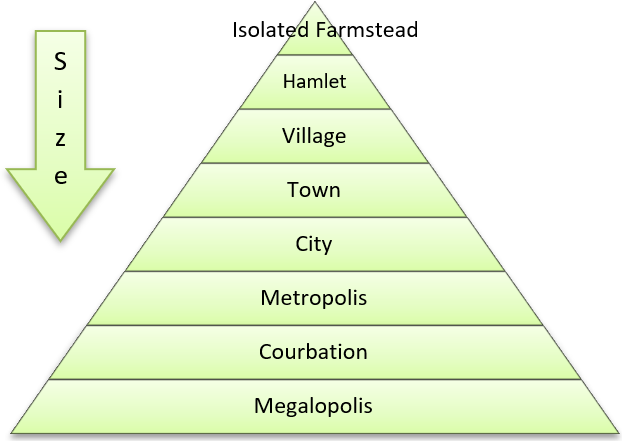

# Settlement Dynamics

## Rural Changes

### Rural Settlement Background

  - **Rural area:** low population density countryside area, where the
    economy is dependent on primary activity.
    
      - **Rural landscape:** visual picture of a countryside settlement
        and how it is perceived.

  - **Greenbelt:** areas of open land retained around a city, where
    development is restricted.

  - **Urbanisation of poverty:** increasing concentration of poverty in
    urban areas, often due to rural-urban migration.

  - **Rural-Urban Continuum:** no sharp difference between settlements,
    there is a graduation.

  - **Settlement patterns**
    
      - **Isolated**
        
          - Due to extreme environmental conditions
        
          - Insufficient natural resources.
    
    <!-- end list -->
    
      - **Dispersed**
        
          - Farmhouses separated by large farm areas.
        
          - No nucleation of properties.
        
          - 2-3 housing hamlets.
    
      - **Nucleated**
        
          - Has economic, social and defensive purpose.
        
          - Originally clustered for defences in war.
        
          - Area of resources (valley region, river confluence, coastal
            location)
    
      - **Linear**
        
          - Properties along roads, rivers and transport lines.
        
          - People want close proximity to transport network.
        
          - Rivers historically used for cooking, cleaning, water.
    
      - **Loose Knit**
        
          - Similar to nucleated, but settlements not closely clustered.
        
          - Farmland separates properties.
        
          - ‘Traditional rural settlement’.
    
      - **Green ring**
        
          - Village built around circular field for communal or
            religious purposes.
    
      - **Planned**
        
          - US city fringes have planned settlements.

  - **Rural perceptions**
    
      - Tight community where people know each other.
    
      - Strong family ties.
    
      - Homogeneity – shared languages, culture, religion.
    
      - Less expressed differences between social classes.

  - **Key Villages:** villages that have a high concentration of
    services, reduced service decline and an assured threshold
    population. They satisfy the needs of surrounding villages/hamlets.
    
      - **Characteristics:** has existing employment/services,
        accessible by public transport and roads, relatively close
        proximity to urban centre, land value high enough to encourage
        development.
