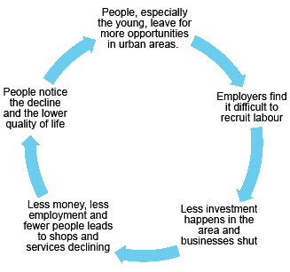
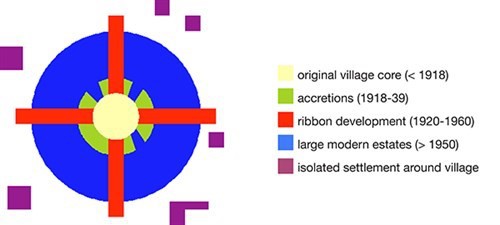

## MIC/HIC Contemporary Issues

* **Rural-Urban migration**
  * Rural depopulation is the primary driver for other rural issues.
    As people leave, BRs decrease below the replacement level –
    leading to cut services. Cut services leads to unemployment and
    further ‘out- migration’.
* **Changes in agriculture**
  * Decline in farm work due to increased mechanisation, reduced
    wages, poorer farmers.
  * Farms increase in size and hedgerow reduces – harming the
    ecological network.
  * Farms bought up by corporations.
  * Farm diversification occurs. Farms used for other industries
    such as tourism. However, too much diversification = oversupply,
    which leads to decline.
* **Service decline (due to lower population density)**
  * Shops, post offices, healthcare, transport and activities
    provide a backbone for communities; they provide a sense of
    belonging which stops people leaving for urban areas.
  * Service decline = reduction in quality of life.
  * **Causes:** depopulation, market forces, changing expectations
    and population patterns, governmental focus on urban areas.

* **Rural transport**
  * Increase in car ownership = public transport decline.
  * Poor, elderly, young and vulnerable are isolated.
  * Creates a barrier for low-income families to access employment.
  * Fuel prices increase.
* **Rural turnaround:** movement back into rural areas, often just
  beyond a cities greenbelt, so commuting is still possible.
  * **Dormitory settlement:** rural settlement that has become
    increasingly urbanised recently, that is largely occupied by
    people employed in nearby urban areas.
  * **Morphological Evolution of suburbanised villages:** shows land
    use changes, ribbons along roads and the addition of
    private/council estates, over time:

* **Second home concept**
  * Urbanites purchase 2nd homes in rural locations.
  * Offers higher local employment and increased taxes paid funds
    communities and services that may have stopped otherwise.
  * More money allows new infrastructure to be installed, services
    have a higher threshold population.
  * However; house prices rise, farm land fragments, visual
    degradation occurs, building work may be sub-standard,
    cultural/environmental issues exist.

