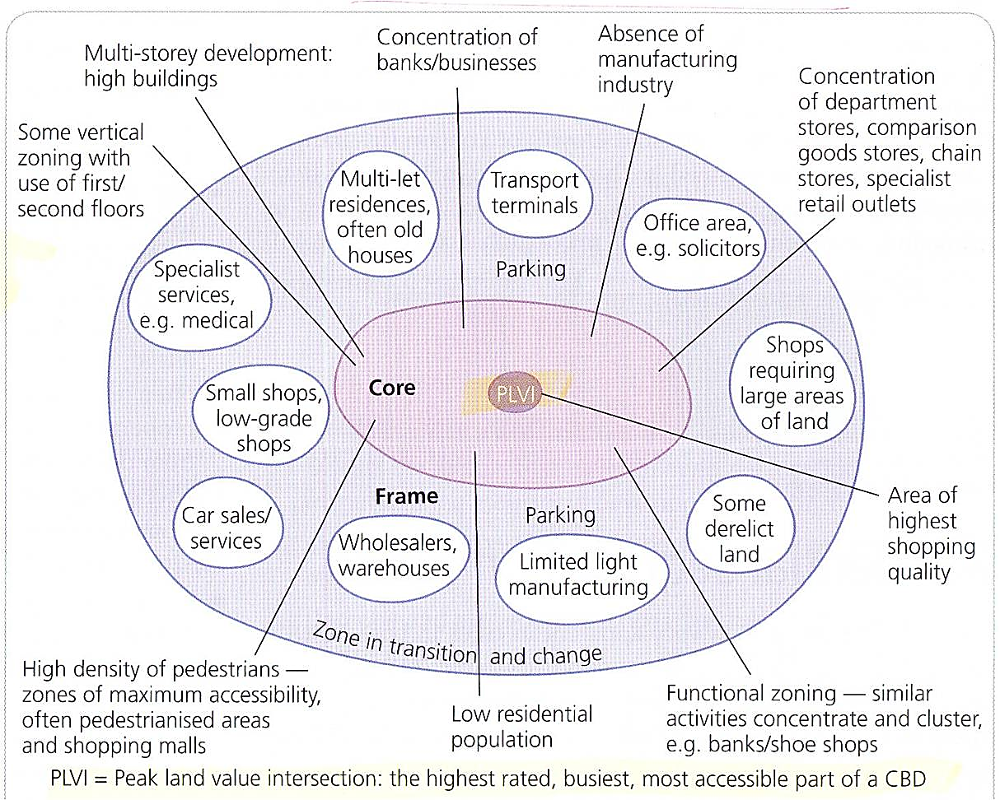

## Changing CBD

* Increased pedestrian zones
* Indoor shopping centres
* Environmental and safety improvements
* Better access, as public transport and road networks improve.
* **CBD decline**
  * Rise in car ownership leads to increased mobility. Leisure
    shopping and congestion become more common. CBD becomes less
    accessible.
  * Planning authorities may encourage/discourage out-of-town
    shopping, leading to changes in how people shop. Uncoordinated
    plans have a negative effect.
  * Land and investments are cheaper on green-field sites, so retail
    industry moves out of CBD. In addition, these sites have good
    access and nice environments.
  * Public perception that area is dirty and unsafe.
  * Urban sprawl blurs previous distinct boundaries, CBD’s location
    fades and becomes less important.
  * CBD development and maintenance cost is high.

