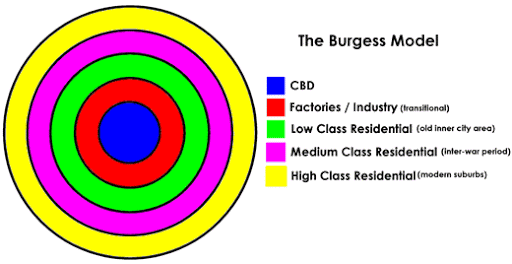
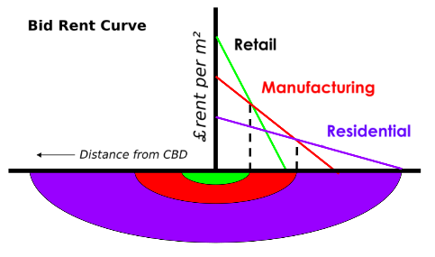
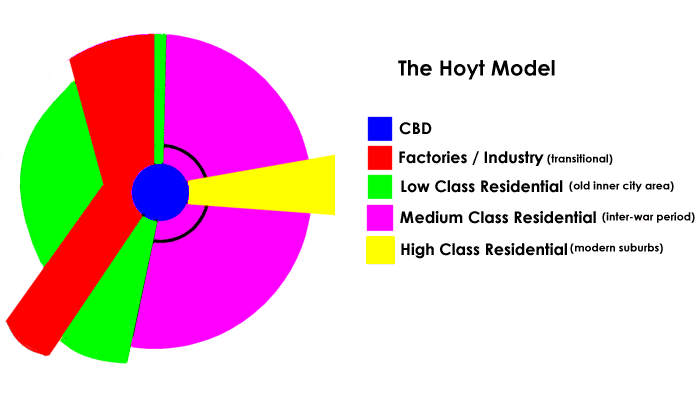
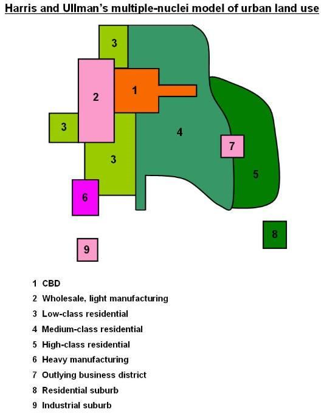
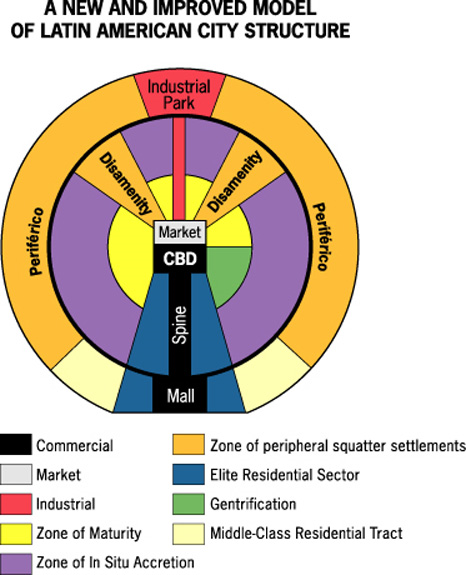

## Space Competition/Functional Zonation

* **Concentric Zone Model**
  * Assumes equal movement, uniform land and free competition for
    space, in all directions.
  * Development is outwards from the centre with continuing
    in-migration.
  * Business activity occurs in CBD as most people have access to
    that central point.
  * Zones of transition outwards, through industry and low-class
    housing­­­­. Migrants drawn to low prices.
  * Areas of better housing further out, as people can afford to
    move out of centre (occupied by middle-class with newer and
    larger houses).

 

* **Bid Rent Theory**
  * Assumptions are the same as the Concentric model.
  * A city centre location is more expensive to buy/rent as it is
    most accessible, so only retail/offices will bid.
  * Moving outwards, industry bids the most, then housing.
  * Poor mobility and low-income groups reside in inner locations
    due to CBD access. High land prices are overcome as people live
    in high densities.
  * Affluent and mobile seek cheaper land for better housing. Space
    traded off for commute time.
  * At line intersection, both uses pay the same, otherwise the use
    line on top will bid more.

 

* **Sector Model**
  * Maintains that most people have access to CBD.
  * Industry follows transport routes.
  * High class residential develops around physical/social features,
    such as rivers. Opposite side of city to where pollution is
    blown by wind.
  * Low class housing forced in less attractive areas, close to
    factories, and in the path that pollution is blown.

 

* **Multiple Nuclei Model**
  * CBD present, but not necessarily in centre of model.
  * Low class housing found in cheap land areas (around industry).
    Higher class avoids industrial land, so locates on opposite side
    of the city.
  * Areas of development occur outside the main settlement around
    new nuclei – such as out-of-town shopping centres.

* **LIC/MIC land use**
  * States a CBD centre with industry that develops around transport
    and waterways.
  * Zone of maturity consists of services, and a mix of old/new
    housing that was once occupied by affluent.
  * Elite housing develops along the commercial spine.
  * ‘In situ accretion’ has a wide range of housing and is in the
    process of improvement through government projects.
  * Squatter settlements locate in the Periférico, on the most
    undesirable land.

* **Urban density gradients:** population density falls with
  increasing distance from the CBD.
  * **HICs:** there is an initial rise and then decline in density,
    as affluent population spreads further rurally.
  * **LICs:** continued density increase, so density gradient is
    kept stable as urban area expands.
    * Due to; low personal mobility/public transport, CBD has a
      residential function (more compact CBD restricts sprawl).
    * High suburban densities do exist, and car ownership is
      increasing, leading to urban sprawl.

