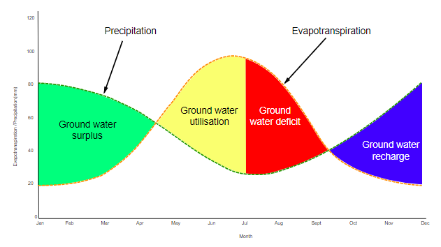

## Stores

* **Interception:** precipitation is caught and stored by vegetation
  before it reaches the ground.
* **Surface Water:** when the infiltration capacity is exceeded, water
  builds upon the surface.
  * **Temporary stores:** puddles and turloughs.
  * **Permanent stores:** lakes and wetlands.
* **Ground Water:** water that has percolated into bedrock. Is a store
  of freshwater - wells and boreholes can be dug below water table to
  access.
  * **Ground Water Recharge:** refilling of rock pores as water
    moves downwards. Occurs when rate of recharge > rate of
    abstraction.
* **Channel Storage:** all water stored in rivers streams and drainage
  channels.
* **Soil Moisture:** water held sub-surface in soil pores. Sandy soils
  have many large pores, so is permeable, and has quick infiltration
  rates. Clays are hygroscopic – clay minerals swell when in contact
  with water, making it impermeable and unstable.
  * **SM Deficit:** available water is being used up.
  * **SM Recharge:** precipitation > potential evaporation. Some
    dry pores refill.
  * **SM Surplus:** soil is saturated, water cannot enter, so flows
    over the surface.
  * **SM Utilisation:** evapotranspiration (and other water uses) >
    precipitation.
  * **Field Capacity:** amount of water held once excess has drained
    away – saturation point.
  * **Wilting Point:** the range of soil moisture content at which
    permanent plant wilting occurs.
  * Balance = Precipitation – (run off + evapotranspiration + change
    in soil moisture).

 