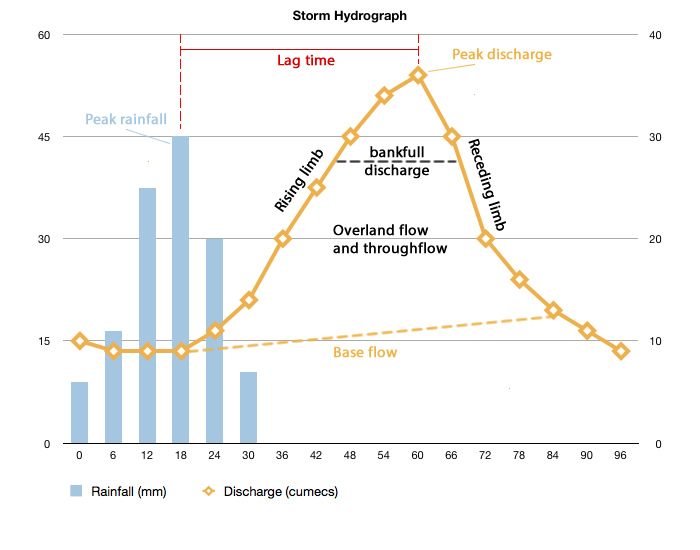

## Discharge Relationships

### Hydrograph Components

A hydrograph plots river discharge against time, and shows the river’s
regime. Used to understand nature of a drainage basin and factors that
affect discharge.

  - **Annual Hydrograph (river regime):** to study responses of the
    river to its environment; highlights seasonal characteristics,
    therefore biggest influencer is climate.

  - **Storm Hydrograph:** shows variations of river discharge over a
    short time period. Includes both discharge and rainfall on the
    y-axis.
    
      - **Cumecs:** cubic metres per second. Unit of discharge.
    
      - **Approach Segment:** discharge prior to storm.
    
      - **Rising Limb:** shows quick rise in discharge.
    
      - **Bank full Discharge:** channel full. Any further increase in
        discharge = flood.
    
      - **Peak Discharge:** maximum river discharge.
    
      - **Lag Time:** time between max rainfall and max discharge.
    
      - **Receding Limb:** less steep than rising, shows discharge
        decline after peak discharge.
    
      - **Stormflow:** stream discharge after rainstorm.
    
      - **Quickflow:** surface runoff reaches channel quickly.

**Storm Process**

1.  Rain falls on drainage basin in large amounts.

2.  Overland flow occurs as precipitation \> infiltration rate. Rising
    limb builds to peak.

3.  After a few hours, overland flow reduces and stops. Throughflow then
    contributes to discharge and stops floodwaters going down as quickly
    as they rose.

4.  Baseflow takes over – back to pre-flood state.