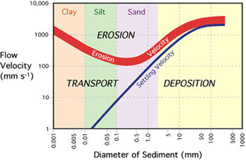

## Hjülstrom Curve

* **Deposition** occurs when there is a reduction in energy, often at
  river mouths, estuaries and deltas.
  * **Energy reduces when:** gradient reduces, friction increases,
    load increases, water volume decreases, water flows on the
    inside of a meander.
* **Sedimentation** occurs when sediment is dropped from still water.
* **Flocculation** is where charged ions in sea water allow clay
  particles to group and settle. Flocculation leads to development of
  mudbanks when water becomes brackish close to the sea.

 

* **Critical erosion velocity:** lowest velocity needed to pick up
  particle of that size - entrainment.
* **Mean settling velocity:** velocity needed to drop particles from
  suspension.

Clays have high entrainment value due to their cohesive nature, and
gravels due to their weight. Sands are easiest to pick up. Clays remain
in suspension if velocity is 0. Velocity for transport is always less
than the velocity required to pick up (entrain) the particle.