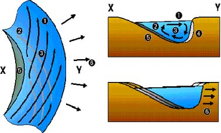

## River Flow

Velocity is affected more by friction than gradient. We can measure
friction with:

* **Bed roughness:**
  $N = \frac{R^{\frac{2}{3}} \times S^{\frac{1}{2}}}{V}$ , where
  **R** is the hydraulic radius, **S** is channel gradient and **V**
  is velocity. Higher the value of **N**, the rougher the riverbed.
* **Hydraulic Radius:**
  $\frac{channel\ depth\  \times \ width}{\left( 2\ x\ height \right)\  + \ width}$

Thalweg is the imaginary line of fastest water velocity down a stream.

* **Laminar:** water flows in sheets parallel to riverbed. No eddies
  or meanders. Common on smooth surfaces.
* **Turbulent:** water closest to bed/banks slowed by friction and is
  overtaken by thalweg. Turbulence created, and water close to banks
  eddies towards the banks, water close to the bed eddies towards the
  bed.
* **Helicoidal:** horizontal turbulence produces a corkscrew motion.
  The thalweg moves both laterally from bank to bank, but also
  vertically from surface to bed during one rotation. 

 