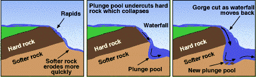

## Landforms

* **Meanders:** a pronounced bend in the course of a river. Pools and
  riffles cause the thalweg to deflect. Where the thalweg is fastest,
  erosion occurs, and deposition where it is slowest. Over time, this
  creates a bend in the river.
  * **River Cliffs:** steep side on the outside of a meander bend
    where erosion is strongest and downwards.
  * **Point Bars:** deposits of sediment on the inside of a meander
    bend, where thalweg is slowest and rising.
  * **Oxbow Lakes:** erosion with the thalweg causes narrowing of
    the bend neck, and after a flood event, the neck is breached.
    Meander cut off with more deposition, creating an oxbow lake.
* **Pools:** deep sections develop where erosion dominates (high
  velocity, dominant laminar flow).
* **Riffles:** shallower sections of the riverbed where sediment has
  been deposited (low velocity, turbulent flow). Steep positive relief
  gradient compared to the negative gradient of the pools.
  * Related to helicoidal flow due to regular spacing.
  * Different gradients creates variations in subcritical and
    supercritical flow, causing erosion or deposition.
* **Waterfalls:** river spills over gradient change where more
  resistant rock is on top of less resistant rock, and splashback
  undercuts rocks by processes of abrasion. Also produced by
  rejuvenation, where there is a knick point. Plunge pool removes
  support for overhang, so collapses. Causes upstream migration.
  * **Gorges:** a deep, steep sided valley caused by waterfall
    retreat.

 

* **Potholes:** turbulence swirls pebbles around a depression in the
  river’s bed. Sides widened and deepened as pebble erodes the cavity.
  Initiated by eddying.
* **Rapids:** upper course feature, where gradient is steep, and
  riverbed is rocky and irregular. Turbulent flow.
* **Bluffs:** old floodplains erode leaving terraces. Meanders erode
  the edge of the terrace, creating a line of steep slopes called
  bluffs.
* **Floodplains:** flat land made up of alluvium next to the river,
  rise during floods, as fine silt is deposited. Backswamps are
  sometimes created during flood events. Riverbed can raise if
  discharge is low, and sediment is deposited.
* **Levees:** following a flood event where banks burst, wetted
  perimeter increases. Increased friction reduces velocity, and coarse
  material is deposited first around the banks, with finer material
  moving across the flood plain causing back swamps.
* **Deltas:** sediment is deposited where the river meets a standing
  body of water, due to a loss of energy. Clay particles flocculate
  and deposit. Bottomset beds (fine material built out by turbidity
  currents) form first, then foreset beds (coarse material carried
  seaward by rolling/saltation), then topset beds (fine material built
  by distributaries).
  * **Arcuate Delta:** fan shaped. Where longshore drift occurs.
  * **Cuspate Delta:** pointed, formed by two opposing currents.
  * **Bird’s Foot Delta:** still sea allows each distributary to
    build in any direction.

