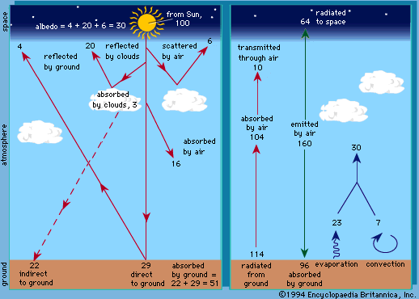

# Atmosphere and Weather

## Diurnal Energy Budgets

### Radiation

* **Incoming Solar Radiation:** shortwave UV insolation is the only
  energy input. Affected by the amount and type of cloud, the Sun’s
  angle.
  * Around 5% is scattered by atmosphere
  * 24% reflected into space by atmosphere
  * 23% absorbed by atmospheric gasses.
  * 48% absorbed by Earth’s surface and heats it.
* **Reflected Solar Radiation:** proportion of energy that is
  reflected back to the atmosphere is its **albedo**. Lighter
  materials have a higher albedo value and therefore reflect more
  radiation energy.
  * **Planetary albedo**: proportion of insolation scattered and
    returned to space by Earth.
* **Surface/Subsurface Absorption:** since darker surfaces absorb more
  radiation, the energy has potential to be transferred to lower
  layers via conduction. If conduction is possible, the surface will
  remain cool as heat is transferred to the soil/bedrock. Conduction
  is encouraged when moisture is present. This heat is released back
  to the surface at night, offsetting night-time cooling.
* **Longwave radiation:** since the Earth is a cold body, it emits
  longwave radiation back to space. Longwave radiation is easily
  absorbed by greenhouse gasses (water and CO2) and by clouds, which
  return the heat to the surface – called the **greenhouse effect**.
  Heat loss is greatest on cloudless nights.

* **Daytime budget =** insolation – (reflected insolation + surface
  absorption + sensible heat transfers + latent heat transfers +
  longwave radiation)
* **Night-time budget =** stored energy – (latent heat transfers +
  sensible heat transfers + longwave radiation)

