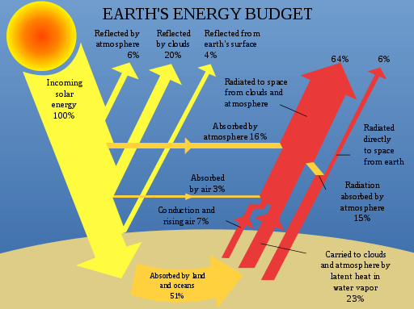
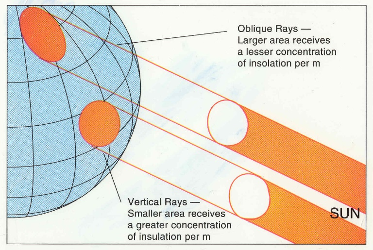

## Global Energy Budgets

### Latitudinal Radiation Pattern

  - **Excess:** positive radiation budget in the tropics. Occurs because
    insolation is so concentrated.

  - **Deficit:** negative radiation budget at higher latitudes.
    Insolation has a larger amount of atmosphere to pass through, there
    is more chance of reflection back to space, and rays are less
    concentrated.

  - **Balance:** neither regions are getting warmer/colder, horizontal
    transfer from the tropics to higher latitudes compensate to global
    insolation differences.

  - **Temperature patterns:** little seasonal variation at the equator,
    but great variation in mid/high latitudes. A lag time exists between
    overhead sun and maximum insolation, as the atmosphere is heated
    from below, not above. Coldest period is after winter solstice, as
    ground continues to lose heat despite resumed insolation. Greater
    lag time over ocean due to high specific heat capacity compared to
    land.
