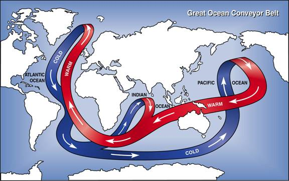

## Atmospheric Transfers

* **Pressure variations:** air moves from high to low pressure.
  Low/declining pressure systems bring poor weather.
* **Surface pressure:** low pressure in equatorial regions, as warm
  air rises and leaves the surface. Higher pressures seen in polar
  regions, where cool air descends onto the surface.
* **Surface wind belts:** uneven due to seasonal variation in
  insolation. Summer in N. Hemisphere causes cooling in southern,
  hence increasing differences between polar and equatorial air.
  Creates stronger high-level westerlies in N. Hemisphere.
* **Ocean conveyor belt:** cold, salty water sinks from polar regions
  and moves towards equator, where warm water gives its heat away to
  the surface winds. More evaporation in North Atlantic, which leaves
  saltier water behind – denser so sinks and cools. Water is
  transported to Pacific, dilutes, less dense so rises.

