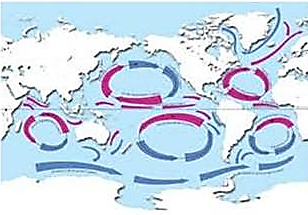
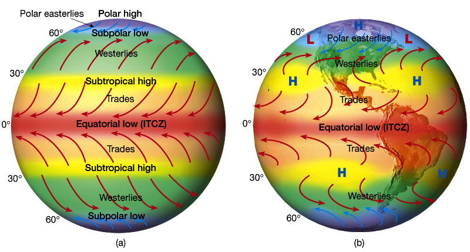

## Seasonal Variations

* **Temperature**
  * **Latitude:** between the tropics, the angle of Sun is high, so
    greater intensity of insolation is received, and hence more
    heating. Where there is more atmosphere to pass through, a
    greater proportion of insolation is lost/scattered/reflected by
    atmosphere. Also, the longer the sun shines, the more insolation
    is received.
  * **Land/Sea distribution**

| Land | Sea |
|----|----|
| Lower reflectivity, so more absorption of radiation (apart from ice) | Higher reflectivity, so less absorption of radiation (especially with low sun) |
| Heat confined to near surface as surface has poor conductors | Sun’s rays penetrate deep, convection currents distribute heat to great depths |
| Low specific heat capacity, so a set amount of energy raises land temp by more | High specific heat capacity, so set amount of energy raises temp by less |
| Less water, so less energy wasted to evaporation | Large amounts of energy used for evaporation |

* **Ocean currents:** surface currents caused by prevailing winds.
  Clockwise rotation in N.Hemisphere, and anticlockwise in
  S.Hemisphere. Water piles into domes and due to Earth’s rotation,
  water is piled up on western edge of ocean basins – return flow is a
  narrow, fast current (gulf stream). Warm currents from equatorial
  regions raise temps in polar regions. Warm surface causes low
  pressure, air moves from high to low, so water moves from cold to
  warm; and winds push warm into warm, exposing cold deep water.
  Process repeats.

 

* **Altitude:** air temperature decreases with altitude, as air is
  thinner, contains less moisture and is therefore less able to absorb
  longwave radiation.

<!-- end list -->

* **Pressure belts:** link between winds and pressure, as heating of
  air causes pressure changes, which puts air in motion thus causing
  the effect of wind.
  * **Pressure changes:** air is driven by the pressure gradient –
    air moves from high to low pressure. Air moves as per the 3-cell
    model, where high pressure is caused where air sinks to the
    ground, leaving space for adjacent air at high altitudes to move
    over and add to the weight of the sinking air mass. Since earth
    is spinning, winds blow at angles due to the Coriolis force.

* **Wind belts:** air will move faster closer to the poles, due to the
  distance between earths axis of rotation and the air. This
  fast-moving air produces jet streams. Air closer to the equator will
  move slower. In addition, faster moving air occurs at high pressure
  zones, due to centrifugal force – because pressure and Coriolis
  force work together.
  * **Coriolis Force:** air masses are deflected due to Earth’s
    easterly rotation. Air moving from high pressure to low pressure
    in the N. Hemisphere is deflected to the right, and to the left
    in the S.Hemisphere acts at right angles to wind direction.
  * **Geostrophic balance:** between Coriolis Force and pressure
    gradient, produces resultant wind – Geostrophic wind. In N.
    Hemisphere, wind blows anti-clockwise around low pressure and
    clockwise around high pressure. ­
  * **Friction:** reduces geostrophic force and wind speed, so
    pressure gradient is no longer balanced by the Coriolis force.
    Makes air more likely to move to low pressure zones.

