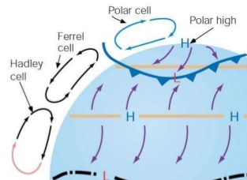

## Global Circulation Model

* **3 Cell Model**
  * **Hadley Cell:** adjacent to ITCZ, where insolation is most
    intense. Doldrums created (permanent low-pressure belt) due to
    constant rising of air, trade winds are drawn in. Air subsides
    around 30°N/S and is deflected right/left depending on
    hemisphere.
  * **Ferrel Cell:** not thermally induced, but a result of adjacent
    cells – creating a ‘cog-like’ system. Air is forced to rise at
    the polar front, and forced to sink at the high-pressure zone,
    where it meets the Hadley cell.
  * **Polar Cell:** cold polar air sinks, creating high pressure. As
    the air moves towards the equator, it spreads out, pressure
    reduces, and it rises. Low pressure zone created at 50-60°N/S.

 

* **Rossby waves:** ridge and trough wave pattern of fast moving
  ‘rivers of air’. 3-6 in each hemisphere, and have their course
  altered by major barriers such as the Andes mountains. Where there
  is a trough, air converges (low pressure system) and at a ridge in
  the wave, air diverges (high pressure system); as the wind rises
  over pressure ridges, conditions at the surface change.
* **Upper westerlies:** fast moving winds that result from a strong
  north/south temperature (and therefore pressure) gradient and the
  Coriolis force. Important for mixing warm and cold air – not
  included in 3 cell model.
* **Jet streams:** narrow column of fast-moving air through the centre
  of Rossby waves. 10km above surface, around 250km/h. Two exist in
  each hemisphere – the polar (30-50°N/S) and subtropical (20-30°N/S)
  jets; both flowing eastward. Jet streams result from differences in
  equatorial/sub-tropical air, and sub-tropical/polar air. Greater the
  difference, stronger the jet stream.

