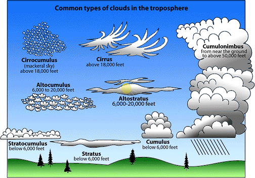

## Types of Precipitation

* **Clouds:** if a cloud is tall enough to prevent sunlight reaching
  its base, it could produce precipitation. The base appears dark –
  such as nimbostratus and cumulonimbus. The latter stretches from sea
  level to the tropopause, forming an anvil head, because the cold air
  cannot rise through the warmer atmosphere.
  * A cloud will not produce precipitation if it is thin enough to
    allow sunlight through, but may form fog if in contact with
    valley side/mountain top.

* **Rain:** liquid water droplets heavy enough to fall to the ground.
  Between 0.5mm and 5mm. Drizzle is rainfall less than 0.5mm. Varies
  in amount, intensity, duration.
* **Hail:** raindrops carried to freezing level inside a cumulonimbus
  cloud, and freeze. Hailstones then collide with supercooled water
  freezing on impact. Rising and falling in the cloud causes repeated
  melting and freezing until the hailstone is heavy enough to fall.
* **Snow:** snow crystals form when temp is below freezing, and water
  vapour turns solid. Heaviest snowfall occurs when warm moist air is
  forced to rise in orthographic or frontal rainfall, as very cold air
  contains limited moisture.
* **Dew:** deposition of water on a surface that occurs in
  anticyclonic systems. Rapid radiation cooling causes ground
  temperature to hit dew point and condensation/direct ground
  precipitation occur.
* **Fog:** forms as a result of radiation cooling. When sun rises, fog
  lifts, possibly causing smog to form under an inversion layer (cold
  air trapped by warm air above it). Fog is common over the sea in
  autumn and spring.
  * **Steam Fog:** localised when cold air blows over warmer water,
    and air becomes saturated due to evaporation, resulting
    condensation causes steam.
* **Advection Fog**
  * Winds move towards pole over cold sea, so chilled to below dew
    point, forming advection fog.
  * Winds blow over cold ocean current, advection fog forms over the
    current.
  * Air passes from sea onto cold land in winter, causing advection
    fog, or hill fog if the air is forced to rise due to relief.
    Drizzle may fall if thick enough.

