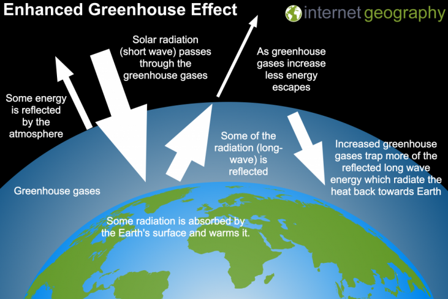

## The Human Impact

### Enhanced Greenhouse Effect

  - Greenhouse gasses such as water vapour, carbon dioxide and methane
    allow shortwave radiation to penetrate, but prevent longwave. This
    traps radiation inside the atmosphere, causing temperature to rise.

  - **Evidence**
    
      - **CO2 (315ppm 1950 400+ppm 2020)** due to increased
        fossil fuel burning and deforestation – which increases
        emissions as well as removing trees that reduce emissions. 5
        gigatons of fossil fuels were burnt in 1980 – 1 ton burnt = 4
        tons CO2 emitted.
    
      - **Methane (increases at 0.5-2% per year),** cattle produces 75m
        tonnes and wetlands 150m tonnes. Methane released as perma-frost
        melts.
    
      - **CFCs (increases 6% each year)** are 10,000x more efficient at
        preventing longwave radiation from penetrating as CO2
        (used as refrigerants aerosol propellants). Also destroys ozone,
        allowing more insolation to enter the atmosphere.
    
      - **Nitrous oxides (increased by 8%)** 300x more powerful than
        CO2, from fertilisers, burning fossil fuels and
        vegetation.
    
      - **Rising sea levels (3.1mm per year)** as a result of thermal
        expansion and melting glaciers. First 60m of ocean warms by
        0.11°C each decade.
    
      - **Ocean acidity (26% acidity increase since 1750)**.
    
      - **Melting ice and glaciers** around the world are showing signs
        of decrease, exposing more land and adding to the sea level
        rise. Arctic ice sheet shrunk by 65% since 1975.

  - **Causes**
    
      - Scientific consensus is that fossil fuel burning is directly
        related to the global temperature increase. This includes the
        emission of the gasses described.
    
      - **Albedo change:** deforestation and urbanisation has resulted
        in more, much darker surfaces, so the ground absorbs more
        radiation, which is released back to the atmosphere – heating
        it.
    
      - **Arguments against include:** orbital eccentricity, axial tilt,
        axial precession, solar output variations, changes in ocean
        currents, and increased atmospheric dust from volcanoes.
    
      - **El Niño:** heats the planet as normal westward surface flow of
        currents reverses and warm water moves east which causes high
        temperatures and drought in Australia and heavy rainfall in
        Peru. **La Niña** produces colder years as a result of cool
        upwellings off the Peruvian coast.

  - **Atmospheric Impacts**
    
      - **Sea Levels:** 200m people could be displaced, 4 million
        km2 of land threatened by floods, 200m at risk from
        flood/droughts. Rise by 2100 is expected to be 26-77cm. 570
        cities exposed, contamination of drinking water (salt
        infiltrates groundwater and aquifers), millions of coastline
        miles under threat.
    
      - **Warming oceans:** 50% increase in marine heatwaves this
        decade. 1°C fluctuation causes plankton and coral to stress and
        bleach (spit out symbiotic algae and die). First 700m of ocean
        absorbs most heat.
    
      - **Storm Activity:** more frequent and intense hurricanes,
        tornadoes etc… Floods have causes \>500,000 deaths and affected
        2.8bn globally, with $8bn in damages in the USA.
    
      - **Agriculture:** USA’s grain belt will decrease, China’s growing
        season will increase, Northward shift for timber and crop
        production. 35% drop in African produce if 3°C temperature rise.
        $10bn in losses in Texas and Oklahoma in a year due to failed
        crops.
    
      - **Drought:** reduced rainfall in Europe and USA will expose 4bn
        to water shortage risks.
    
      - **Disease:** 60 million more people exposed to Malaria, as
        mosquitos breed faster in the heat.
    
      - **Wildlife:** 40% of species will become extinct at +2°C.
    
      - **Tourism:** previously undesirable areas may become tourist
        hotspots, and likewise for desirable places becoming
        undesirable.
    
      - **Cost: 1 tonne** CO2 causes £45 of damage. Solving
        the effects could cost 5-20% of each country’s GDP, whereas
        action now may only cost 1% of each GDP.
