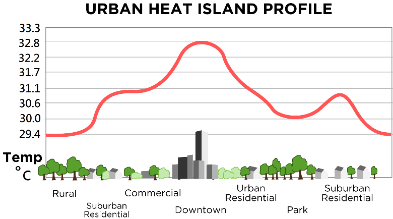

## Urban Climates Theory

* **General impacts and causes**
  * **Higher temperature:** greater surface area to absorb heat, low
    albedo of tarmac (10%) and concrete (20%) so less insolation is
    reflected (higher specific heat capacity surfaces), high
    buildings trap insolation and absorb heat, low buildings causes
    street to collect heat, more heat for atmosphere due to reduced
    evapotranspiration, pollutants trap heat.
  * **Lower humidity:** lack of vegetation so less transpiration,
    high drainage density removes water, fewer water bodies so less
    water available to evaporate.
  * **More intense storms:** greater instability of air, hence
    stronger convection above urban areas.
  * **Slower winds:** wind scattered by buildings.
  * **Less snowfall:** due to higher temperatures.
  * **Human activity:** radiant heat from heating systems and
    buildings can contribute up to 50%.
  * **Tiny specific anomalies:** often above canals/rivers.
  * **Insolation:** due to pollution, longwave radiation is trapped,
    and insolation reduced. Warming occurs by the afternoon and
    mornings are colder than rural areas.
* **Microclimate Mitigation:** London Plane tree.
  * Installation of urban forest. Reduces ambient temperatures by
    3-5°C by shading and increased evapotranspiration. Air quality
    improves too – so trees added to city schools. ‘Living’ roofs
    are popular.

