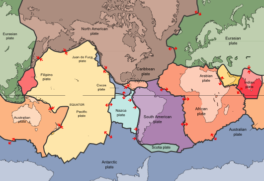
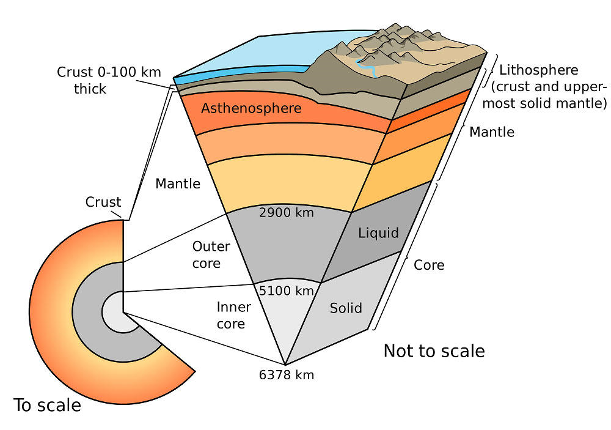

# Rocks and Weathering

## Plate Tectonics

### Nature of Tectonic Plates

* **Evidence**
  * Coastline fit of continents (Africa and South America)
  * Orogenic belt fit (Britain, Norway and Newfoundland)
  * Fossil remains in India match Australian ones. Since these
    animals couldn’t swim, plates must have been connected.
  * Glacial deposits (Brazil matches West Africa)
  * Identical sedimentary sequences along Atlantic coastlines
    (Africa and South America)
* **Continental crust:** 35-70km thick, > 1500m years old, granite
  composition, rich in Silicon and Aluminium, less dense
  (2.6kgm-3), light colour.
* **Oceanic crust:** 6-10km thick, < 200m years old, Basalt
  composition, rich in Iron and Magnesium, denser
  (2.9kgm-3), dark colour.
* **Movement**
  * **Convection Theory:** radioactive decay in Earth’s core
    produces heat. Hot magma rises in convection currents, cools at
    the surface and sinks as denser.
  * **Hotspot:** lava plume through mantle responsible for original
    crust rifting. Outward flow of viscous magma creates drag force
    on plates causing movement.
  * **Ridge push:** magma intrusion at ocean spreading ridges, which
    propels the two plates apart.
  * **Slab pull:** the force that the sinking (colder and denser)
    edge of the plate exerts on the rest of the plate.

