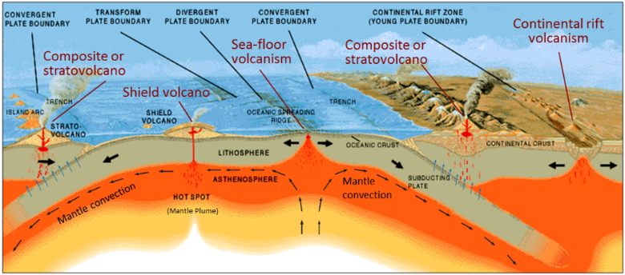

## Types of Plate Boundaries

* **Oceanic constructive:** rising convection lifts lithosphere
  creating a ridge. Extensional forces cause stretching and a fissure.
  Fissure opens and exposed magma fills gap, then cools and
  solidifies. MAGMA DOES NOT OVERFLOW TO FORM TOPOGRAPHIC HIGH.
  * **Mid-Atlantic ridge:** 0.7-1.4cm per year.
* **Continental constructive:** as above, but less vigorous pull so no
  clean break. Pulled thin creating fractures, faults develop and
  central block slides down creating a rift valley which may fill with
  water.
  * **East-African rift valley:** 2cm per year.
* **Oceanic/Continental destructive:** plates forced together and
  oceanic plate subducts since denser. In the Benioff zone, crustal
  melting occurs, and resultant magma forced through cracks – to form
  volcanoes. Subducting plate drags down crustal material to form an
  ocean trench.
  * **Juan de Fuca and N.American plate:** 3cm per year.
* **Oceanic destructive:** plates forced together, older plate
  subducts as is denser. Forced 100 miles below and melts – producing
  magma chambers. Lower density magma rises through cracks allowing
  volcanic eruptions.
  * **Japanese Arcs:** 7-11cm per year.
* **Collision:** powerful collision between two continental plates.
  Both densities are lower than the mantle’s, so prevented subduction.
  Some subduction occurs as lithosphere breaks free. Crust fragments
  are trapped in collision zone, cause deformation. Intense
  compression results in folding.
  * **Himalayan Mountain Range:** 5-6cm per year.
* **Conservative:** plates slip past each other with relative
  horizontal movement (sinistral = left, dextral = right). Lithosphere
  is neither created nor destroyed. Extensive earthquakes.
  * **Strike-slip:** simple offset.
  * **Transform:** two divergent boundaries push together.
  * **San Andreas Fault:** 3-5cm per year.

