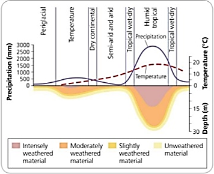

## General Factors Affecting Weathering

* **Climate**

 

* **Rock Type:** some minerals, cements (in sedimentary rocks) are
  more resistant to weathering than others.
  * Limestone is susceptible to carbonation (CaCO3).
  * Sandstone contains iron, therefore oxidation prone.
  * Quartz is chemically resistant, cannot be chemically weathered.
* **Rock Structure:** differential resistance along lines of weakness
  and grains control water movement.
  * Larger grain results in faster weathering, as there is greater
    void space and high permeability.
  * Natural lines of weakness in rock formations allow water to
    penetrate – increasing weathering effects.
  * Rocks can be **porous/non-porous** (measure of open space
    between grains) and **permeable/impermeable** (measure of ease
    of ability to transmit water). More permeable = more weathering.
* **Vegetation:** increased organic acid production and carbon dioxide
  increases carbonation. Physical weathering may reduce as temperature
  are moderated. Roots will increase biological weathering.
* **Relief:** affects temperatures and exposure.
  * Weathered material must be removed to allow the process to
    continue. If a slope is too steep, water runs away. If too
    shallow, no material is removed.
  * Colder temperature occurs higher, so freeze-thaw is dominant at
    higher altitudes.
* **Human activity:** increased weathering due to increased airborne
  chemical pollutants and acid rain. Vegetation removal reduces
  chemical/biological weathering (fewer organic acids).

