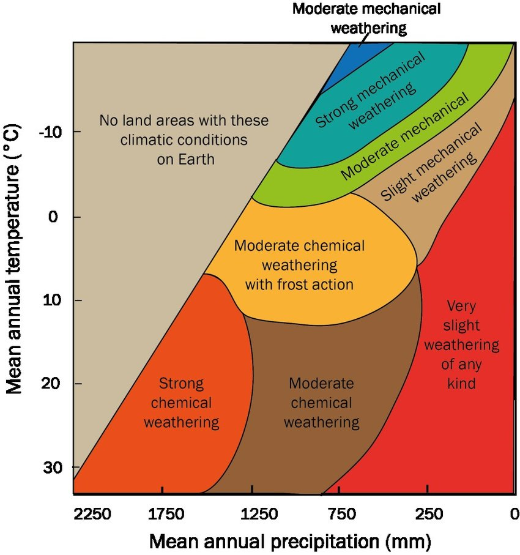

## Specific Factors Affecting Weathering

* **Temperature**
  * **Glacial:** freeze-thaw is dominant, but number and duration of
    cycles is more important than degree of ice. Likely slow
    chemical weathering, but common hydration. **Alaska 0.04mm/yr.**
  * **Temperate:** chemical and biological processes are dominant
    due to abundance of moisture and vegetation. High organic
    contents, carbonates deposited at dry areas. **Askrigg
    0\.5-1.6mm/yr.**
  * **Arid/Semi-Arid:** evaporation exceeds precipitation, so
    mechanical processes are dominant. In semi-arid areas thick
    organic layers lead to leaching and CaCO3
    accumulation. **Egypt 0.0001-2.0mm/yr.**
  * **Humid tropical:** high seasonal rainfall and high temperatures
    results in significant chemical weathering. **Florida
    0\.005mm/yr.**
  * **Van’t Hoff’s Law:** rate of chemical weathering increases 2-3x
    for each 10°C temperature rise up to 60°C.
* **Rainfall**

