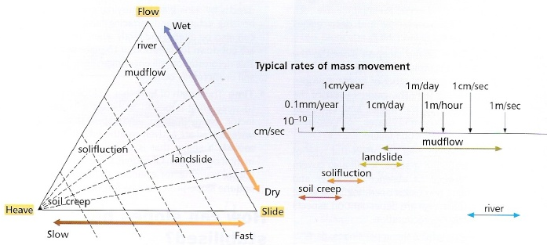

## Slope Processes

### Slope Processes

  - **Slope:** any inclined surface (hill slope) or a slope angle.

  - **Categorising movements**

  - **Slope failure causes**
    
      - **Increased shear stress:** removal of lateral support
        (undercutting/slope steepening), removal of underlying support,
        slope loading, lateral pressure, transient stresses.
    
      - **Decreased shear strength:** weathering effects, changes in
        pore-water pressure, changes of structure, organic effects.

  - **Opposition to movement:** friction, cohesive forces, pivoting,
    vegetation.
