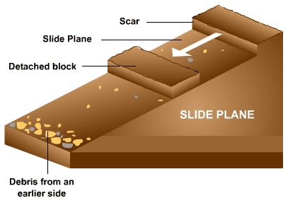
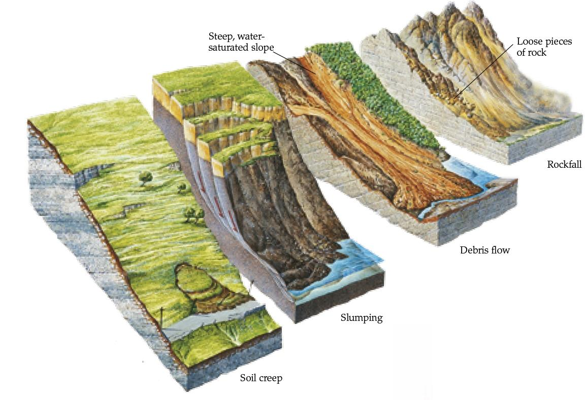

## Mass Movement

* **Heaves (soil creep):** slow movement of material where soil
  particles are heaved to the surface by wetting, heating and freezing
  of water. Occurs mainly in winter.
  * Particles move perpendicular to the surface (path of least
    resistance), and then fall under gravity once particle has
    dried, cooled or water thawed. Net movement is down the slope.
  * 1-3mm per year in UK. 10mm per year in rainforest.
  * **Evidence:** tension cracks in roads, tilted poles,
    terracettes, soil piled behind field stone walls.
  * **Talus Creep:** slow movement of fragments along a scree slope.

   

* **Slumps:** weaker rocks such as clays ‘slump’ with a rotational
  movement along a curved slip plane.
  * Clay saturates and flows along slip plane. Commonly occurs if
    the base has been undercut.
  * Produces separate, jerky events.
* **Flows:** more continuous, smoother form of slump. Occurs in deeply
  weathered clay, and if particle size is the same or smaller than a
  grain of sand.
  * Mudflows are faster than earthflows (which are deeper and
    thicker).
  * Higher water content allows flows to occur on shallower slopes.
  * Can occur on saturated toe of a landslide, or as a separate
    event.
* **Falls:** occurs on steep slopes (>40°), with bare rock faces and
  exposed joints. Initial cause of rocks falling is erosion or
  weathering.
  * Rocks detach and fall freely under gravity. If fall is short, a
    straight scree is produced; otherwise a concave scree is
    produced.
  * Significantly contribute to the retreat of steep rock faces and
    providing debris for scree/talus slopes.
* **Slides:** when an entire mass of material moves along a slip
  plane. Can be rock/landslides, or a rotational slide. Material holds
  its shape until hitting the slope bottom.

   
  * **Conditions:** weak rocks, steep slope, active undercutting, intensely cold conditions or sudden change in water content.
  * **Landslides:** when material moves downslope as a result of
    shear failure. Downward force > resistance. An increase in
    water content reduces strength (particles pushed apart) and more
    mass is added.
  * **Rockslides:** large rock mass slides down slip plane.

* **Slip plane:** junction between two layers along a bedding line, or
  the joint between two rock types. Point beneath the surface where
  shear stress > shear strength.

