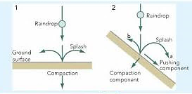

## Water and Sediment Movement

* **Surface wash:** occurs when the soil’s infiltration capacity is exceeded by precipitation rate. Hortonian flow.
* **Sheetwash:** unchanneled (sheet like) flow of water over soil’s surface. Some high/low velocity sections may develop. Transports material dislodged by rain splash, by eroding a uniform layer of soil. Produces rills.
  * **Rills:** shallow channels that carry water and sediment for a
    short period of time. Common in agricultural lands after
    harvesting (bare land) and after compaction of the soil by heavy
    machinery.
* **Rain splash:** raindrops have an erosive effect. This effect is
  most prominent on slopes with inclines between 33° and 45° at the
  start of a rainfall even, when the soil is loose.
  * **5° slope:** 60% of movement is downwards.
  * **25° slope:** 95% of movement is downwards.

 