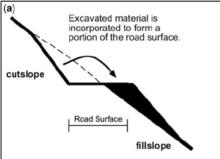
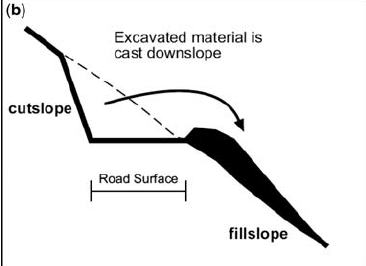

## The Human Impact

### Impact of Human Activities on Stability

  - **Excavations:** cutting into a slope and leaving loose excavated
    creates a slope too steep to have stability, and is therefore prone
    to failure. Excavation at the toe of a slope removes the supporting
    section of the slope.

  - **Waste heaps:** highly porous mounds of waste material from
    quarrying and mining leaves new, unstable steep slopes. Slips occur
    with soil saturation after rainfall.

  - **Loading**
    
      - **Buildings:** add mass to slope, increase slip likelihood.
    
      - **Water:** drainage routes disturbed by building foundations -
        excess water in soil increases mass and will lead to slips (also
        has lubricating properties). If saturated soils are subjected to
        an earthquake, liquefaction can occur (pressure between
        particles makes soil act as a liquid).

  - **Vegetation removal:** deforestation leaves land bare (increased
    surface runoff, more erosion). If roots die/are removed, material is
    no longer bound together, and stability is compromised.

  - **Traffic vibrations:** may trigger mass movements.

  - **Footpath trampling:** intensified localised erosion.

  - **Construction on slopes:** uses cut-and-fill technique (as
    described in excavation).

 

  - **EROSION PROCESSES:** can be increased by the removal of
    vegetation, ploughing up and down slopes (creating water channels
    and rills) and destruction of the soil structure (through
    overgrazing/growing, allowing organic deterioration).
