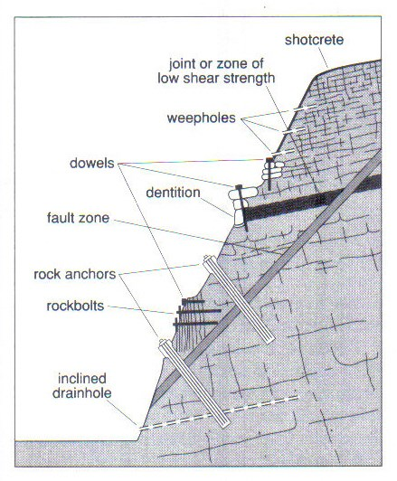

## Strategies to Modify Slopes

* **Pinning:** rock bolts, dowel bars and ground anchors installed to
  hold loose rock into stable rock below. Ground anchors penetrate
  deeper, through different rock strengths.
* **Netting:** metal mesh nets attached to slope surface, prevents
  loose rocks falling onto road/rails below.
* **Grading:** process of reducing the slope angle (by excavation) to
  reduce the risk of movement. Material must be transported away, so
  costs can be high.
* **Afforestation:** adding vegetation increases the interception, so
  less surface runoff and erosion occur. Reduces mudflows. More roots
  hold the soil bound. Reduced infiltration means the slope has less
  mass.
* **Gabions:** metal mesh boxes used to stabilise the toe of a
  landslip.
* **Drainage:** excess water adds mass to slope and lubricates it.
  Trenches dug (filled with permeable aggregate) to quickly remove
  water from a slope.
* **Grouting:** permeable rocks injected with cement to increase
  strength and reduce pore water capacity.
* **Shotcrete:** loose surfaces sprayed with concrete to prevent loose
  rocks from falling.

