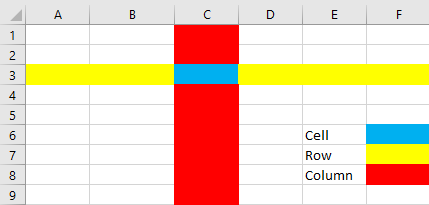
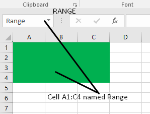

# Spreadsheets

## Create a Spreadsheet

| **Term** | **Definition** |
|----|----|
| Cell | A rectangle within a spreadsheet where data can be positioned |
| Formula | A mathematical calculation |
| Orientation | The direction of text, for example horizontal or vertical |
| Alignment | Positioning text so that it is in line, for example on the left, right or centre |
| Function | A ready-made formula representing a complex calculation |
| Validation | The process of checking if data matches specific rules |
| Verify | To check that data matches the original data |
| Row | A horizontal set of cells |
| Column | A vertical set of cells |
| Range | A set of one or more cells referenced by a name |
| Worksheet | A set of rows and columns |
| Workbook | A set of one or more worksheets |

 

 