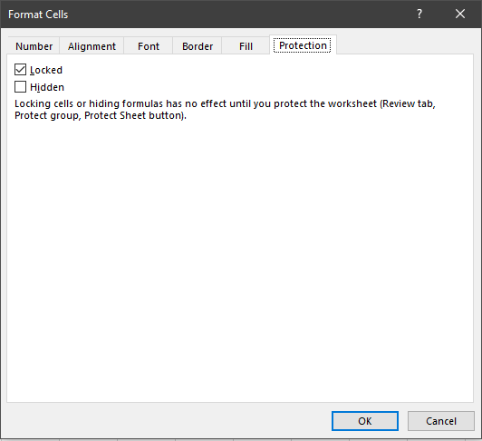
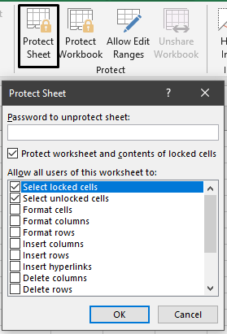

## Spreadsheet Security

  - Different parts of the spreadsheet can be secured depending on the
    software being used. This allows developers to:

<!-- end list -->

  - Prevent Individual worksheets from being removed

  - Prevent new worksheets from being added

  - Prevent changes being made to certain data, and select certain
    individual cells, rows or columns.

  - Protect the worksheet, but still allow users to enter data into
    certain cells.

  - Prevent formulas from being seen and/or changed.

 
 
 
