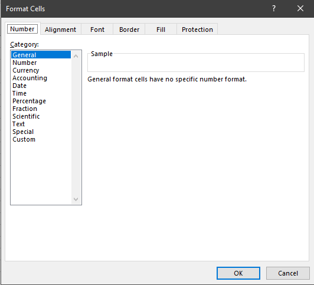
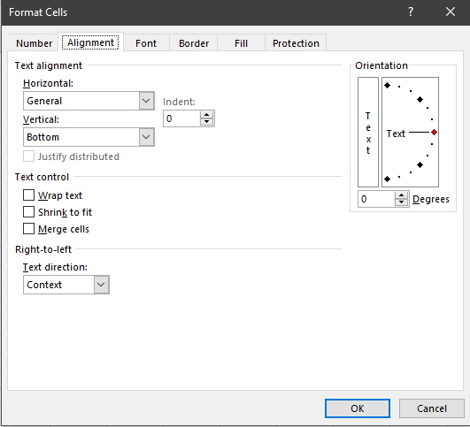
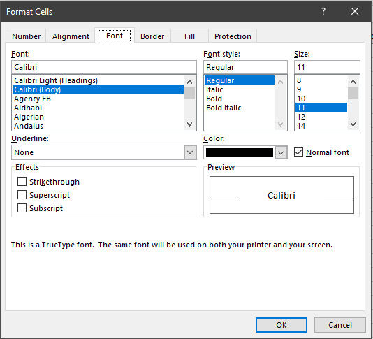
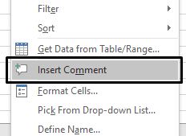
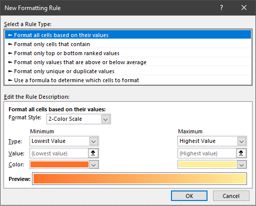
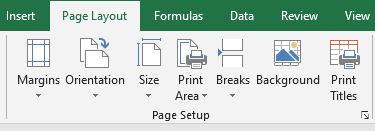
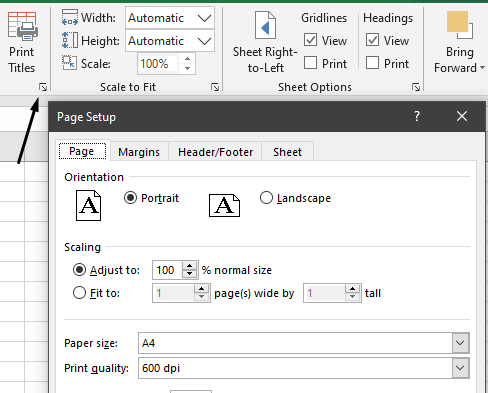
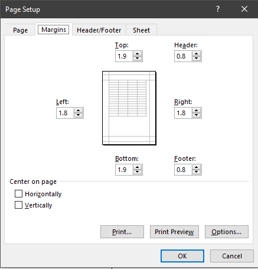
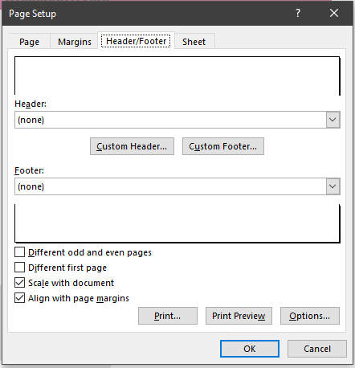

## Format a spreadsheet

  - Format Data Type- The cells in a sheet can be formatted to be in a
    specific data type
    
    

<!-- end list -->

  - Change Text Orientation and Alignment- The text in a cell can
    oriented to either diagonal or vertical , and be aligned either to
    the left, right or centre
    
    

  - Emphasis Certain Cells- Certain cells can be formatted to standout.

  - Comments can be added.
    
    

  - Conditional Formatting- Cells can be formatted based upon certain
    conditions being met.
    
    

  - **Page Formatting**
    
      - Page Setup
        
        
    
      - Fit to Page
        
        
    
      - Margin  
        
    
      - Header and Footer
        
        
