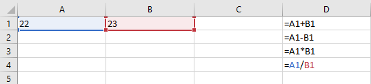
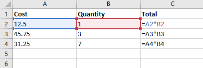
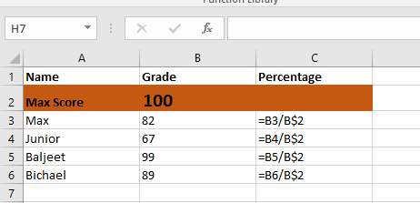
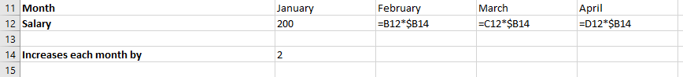
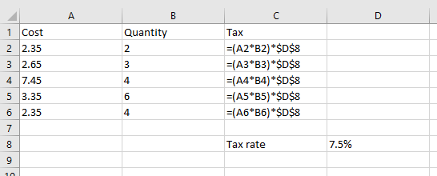
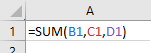
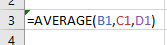
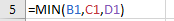
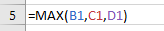

## Create Formulae and Functions

* **Formulae-** A formula uses basic arithmetic calculations, which
  use +,-,\* and /.

 

* **Relative Cell Referencing-** RCR is used when you want the content
  of a cell change based on its relation to its row and column
  position.

   

<!-- end list -->

* **Absolute Cell Referencing-** ACR is used when you do not want a
  cell reference to change when other cells are filled in, or when
  replicating formulae.
  * \
    To stop a row from being changed, add $ before the row number 
  * \
    To stop a column from being changed, add $ before the column
    letter 
  * \
    To stop both column and row changing, a $ must be put ‎before
    the column letter and row number 

<!-- end list -->

* **Functions-** They are ready-made formulae representing ‎a complex
  calculation.‎
  * Summary Functions

<table>
<thead>
<tr class="header">
<th>

<strong>Function</strong>

</th>
<th>

<strong>Purpose</strong>

</th>
<th>

<strong>Example</strong>

</th>
</tr>
</thead>
<tbody>
<tr class="odd">
<td>

SUM

</td>
<td>

Calculates the total of values within a

range

</td>
<td></td>
</tr>
<tr class="even">
<td>

AVEREGE

</td>
<td>

Calculates the average of values within a

range

</td>
<td></td>
</tr>
<tr class="odd">
<td>

MININUM

</td>
<td>

Calculates the smallest value within

a range

</td>
<td></td>
</tr>
<tr class="even">
<td>

MAXIMUM

</td>
<td>

Calculates the largest value within

a range

</td>
<td></td>
</tr>
</tbody>
</table>