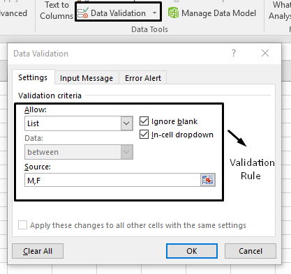
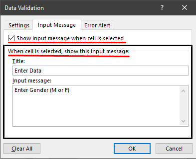
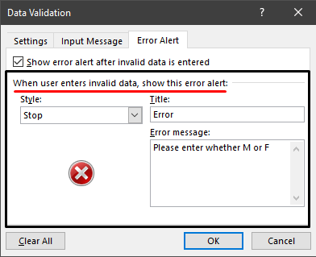

## Validation rules‎

Validation rules can be applied to data in a spread sheet. If the data
passes the validation rule, it will be ‎accepted. However if the fails
the rule, it will be rejected and an error message will be shown.‎

