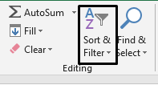

## Filter data

* Data in a spreadsheet can be filtered so as to only ‎show the data
  that is required  
* Text Filters

<table>
<thead>
<tr class="header">
<th>

<strong>Filter</strong>

</th>
<th>

<strong>Purpose</strong>

</th>
<th>

<strong>Example</strong>

</th>
</tr>
</thead>
<tbody>
<tr class="odd">
<td>

Contains

</td>
<td>

Selects data that in a column that contains specific

text

</td>
<td>

Contains “AB” will only show data which contains the letters A and B

</td>
</tr>
<tr class="even">
<td>

Starts with

</td>
<td>

Selects data that starts with the text specified

</td>
<td>

Starts with “AB” will only show data that starts with the letters A and B

</td>
</tr>
<tr class="odd">
<td>

Ends with

</td>
<td>

Selects data that ends with the text specified

</td>
<td>

Ends with “AB” will only show data that ends with the letters A and B

</td>
</tr>
</tbody>
</table>