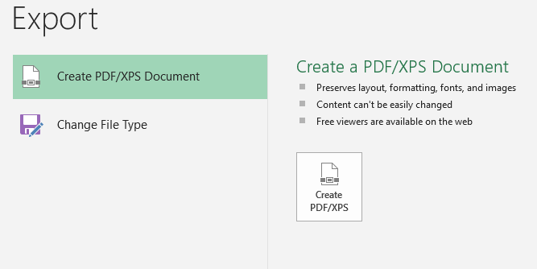
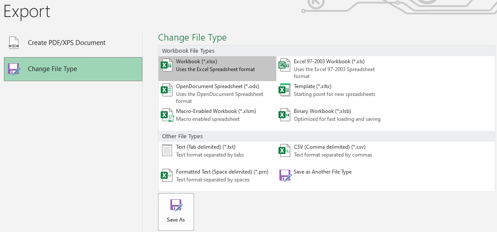

## Import and export

  - Data can be imported from other formats such as CSV (Comma Separated
    Values) file, TXT (text) file, or from another database. It is
    important that you select the option to show all the files when
    importing a file.

  - Data can be exported in multiple formats, such as CSV, TXT, PDF,
    HTML (Webpage), etc.  
      
      
    
