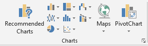
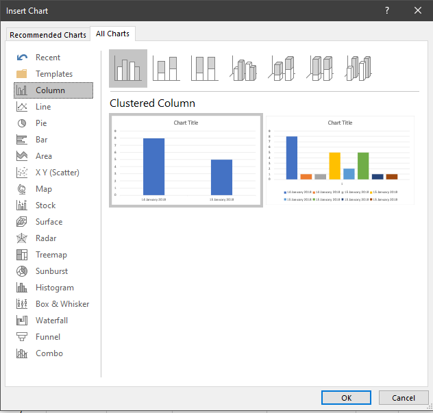
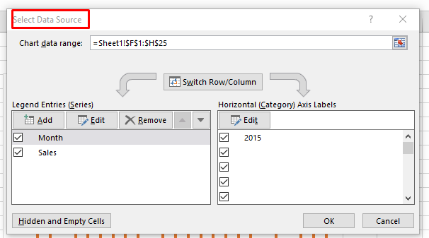
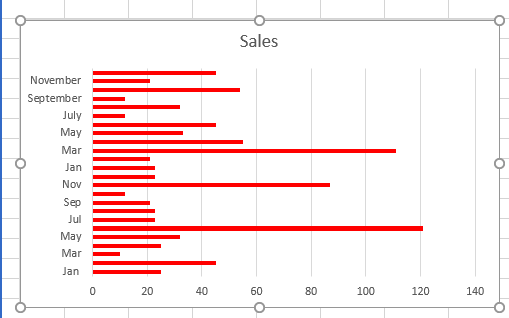
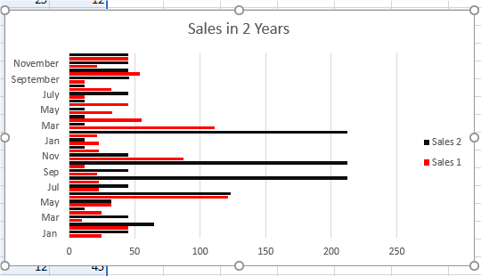
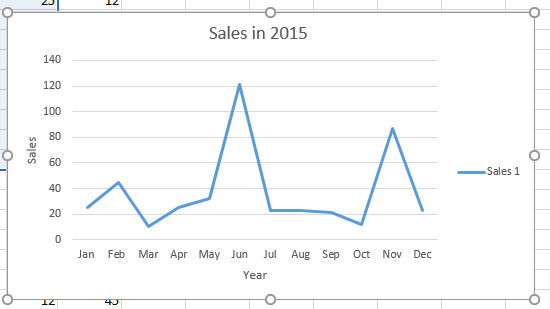
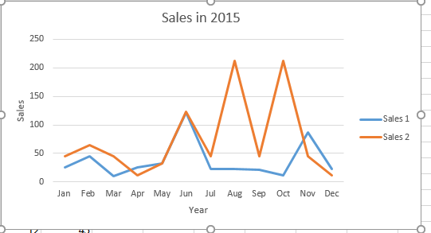
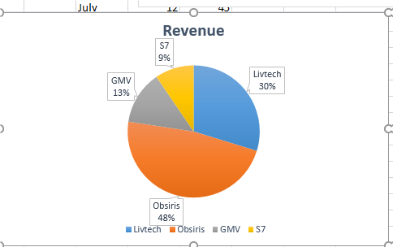

## Graphs and charts

  - Graphs and charts are used in a worksheet to present data in a
    format that allows users to compare values.  
      
      
      
      
    

  - **Bar/Column chart-** Used to show a single series of ‎data in
    columns or rows.‎  
    

  - **Comparative bar/ Column chart-** Used to compare more than one
    series of data in columns or rows.  
    

  - **Line Graph-** Used to show how a single series of data changes
    over a period of time.  
    

  - **Comparative line graph-** Used to compare how ‎more than one
    series of data changes over a period ‎of time.‎  
    

  - Pie chart- Used to show the proportion that is used ‎by each item of
    data.‎  
    
