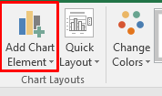

## ‎Create a graph or chart‎

  - When creating a graph or chart, they should be ‎labelled
    appropriately.‎  
    

<table>
<thead>
<tr class="header">
<th>

<strong>Label</strong>

</th>
<th>

<strong>Purpose</strong>

</th>
</tr>
</thead>
<tbody>
<tr class="odd">
<td>

Title

</td>
<td>

A brief overview of what the graph chart is showing

</td>
</tr>
<tr class="even">
<td>

Legend

</td>
<td>

A key to show what the colours used represent

</td>
</tr>
<tr class="odd">
<td>

Value axis

</td>
<td>

Each of the axes (x and y) should include the values including the any units

</td>
</tr>
<tr class="even">
<td>

Category axis

</td>
<td>

Each of the axes should

include a title to state what the data represents

</td>
</tr>
<tr class="odd">
<td>

Percentages

</td>
<td>

When using a pie chart , the percentages may need to be displayed for each segment

</td>
</tr>
<tr class="even">
<td>

Segmented labels

</td>
<td>

Instead of legend, each segment in a pie chart could be labelled with its description

</td>
</tr>
<tr class="odd">
<td>

Segmented value

</td>
<td>

As well as, or instead of the percentage, each segment in a pie chart could be labelled with its quantity

</td>
</tr>
<tr class="even">
<td>

Scale

</td>
<td>

The interval between each value on an axis

</td>
</tr>
<tr class="odd">
<td>

Axis scale maximum

</td>
<td>

The maximum value to be used on an axis

</td>
</tr>
<tr class="even">
<td>

Axis scale minimum

</td>
<td>

The minimum value to be used on an axis

</td>
</tr>
</tbody>
</table>
