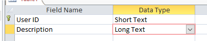
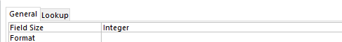
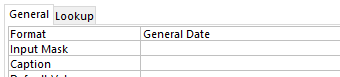
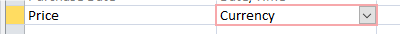
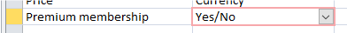
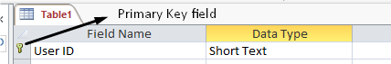
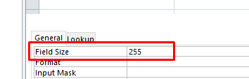

## Data types and field sizes

  - Each field in a table will have data type assigned to it
    
      - **(Short/Long)Text-** Used for titles, names, descriptions, etc.
        Short text (or Alphanumeric) can hold a maximum of 255
        characters, ‎while Long text can hold more than 255 characters
        (60,000 and upwards). Can include numbers, letters and symbols.
        ‎  
        
    
      - **Number (Integer/Decimal) -** Used for numeric values. Integer
        is used in fields which only contain whole numbers, while
        Decimal is ‎used for decimal values. ‎  
        
    
      - **Date/Time-** Used to store date and time values. The ‎format
        of the data can be specified.‎  
        
    
      - **Currency-** Used for Currencies. Depends on ‎the regional
        setting on the Computer.‎  
        
    
      - **Yes/No (Boolean) -** Used ‎when the data need to ‎be either
        yes or no.‎  
        
    
      - **AutoNumber-** Used to ‎generate a value (usually ‎numeric)
        that is unique to ‎each record. They are used ‎in Primary key
        fields and ‎this field is used to ‎distinguish between each
        ‎record.‎  
        
    
      - **Field size-** Each field will have a maximum field ‎size; some
        field sizes can also be specified  
        
