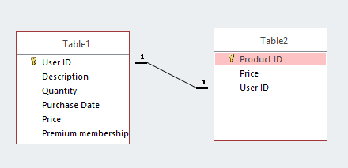
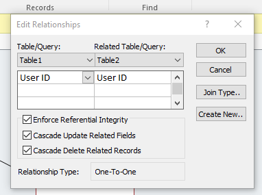
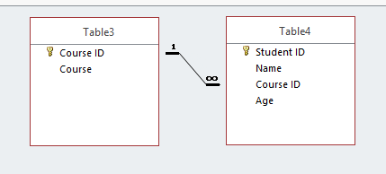
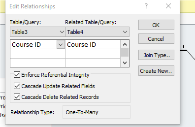
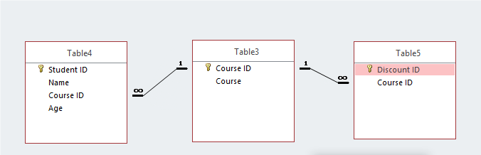

## Relationships

  - Database relationships can be used to connect ‎entities together

  - **One-to-one Relationship**
    
      - In this relationship, each record in one table is connected to
        one record in another table
    
      - Each foreign key value will only be linked to one primary key
        values and Vic versa.
    
      - The data type and field size must be the same for the two fields
    
      - Only data items that is present in the primary key can be used
        in foreign key (**Referential Integrity**)
    
      - Make sure the index for both fields is set to **Yes (No
        Duplicates)**

  - **One to many Relationship**
    
      - In this relationship, each record in one table is connected to
        many records in ‎another table
    
      - The foreign key will be on the many side of the relationship
        while the primary key will ‎be on the one side of it
    
      - The data type and field size must match
    
      - Only data present in the primary key (one side) of the
        relationship can be present in the foreign key ‎‎(many side)

‎
 

  - **Many-to-many Relationships**
    
      - These are basically two sets of One-to-many relationships

