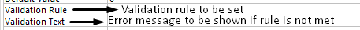

## Validation and verification

  - Validation- Validation rules can be applied to data in the database

  - Types of validation
    
      - Lookup in list
    
      - Range
    
      - Data type
    
      - Format
    
      - Length
    
      - Presence

<table>
<thead>
<tr class="header">
<th>

<strong>Rule</strong>

</th>
<th>

<strong>Type</strong>

</th>
<th>

<strong>Purpose</strong>

</th>
</tr>
</thead>
<tbody>
<tr class="odd">
<td>

“M” or “F”

</td>
<td>

Lookup in list

</td>
<td>

Must be either “M” or “F”

</td>
</tr>
<tr class="even">
<td>

IN(“Mrs.”, “Mr.”, “Miss”, “Dr”)

</td>
<td>

Lookup in list

</td>
<td>

Must be any of the values in the list

</td>
</tr>
<tr class="odd">
<td>

&gt;DATE()

</td>
<td>

Range

</td>
<td>

Must be after today’s date

</td>
</tr>
<tr class="even">
<td>

&gt;28/03/1980

</td>
<td>

Range

</td>
<td>

Must be after the date listed

</td>
</tr>
<tr class="odd">
<td>

Between 3 And 10

</td>
<td>

Range

</td>
<td>

Value must be greater than 3 but less than 10

</td>
</tr>
<tr class="even">
<td>

&gt;2

</td>
<td>

Range

</td>
<td>

Value must be greater than 2

</td>
</tr>
<tr class="odd">
<td>

Like “[A-Z][A-Z]”

</td>
<td>

Data type

</td>
<td>

Must be two text characters

</td>
</tr>
<tr class="even">
<td>

Like”*@*.*”

</td>
<td>

Format

</td>
<td>

Email address

</td>
</tr>
<tr class="odd">
<td>

IS NOT NULL

</td>
<td>

Presence

</td>
<td>

Field must not be empty

</td>
</tr>
</tbody>
</table>
