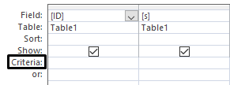

## Searches

  - It is possible to filter out data in a database by using certain
    criteria ‎

  - **Simple queries-** Used for searching data with a single criteria
    using a premade table  
      
      
    

<table>
<thead>
<tr class="header">
<th>

<strong>Criteria</strong>

</th>
<th>

<strong>Format</strong>

</th>
<th>

<strong>Purpose</strong>

</th>
</tr>
</thead>
<tbody>
<tr class="odd">
<td>

Equals to

</td>
<td>

“X”

</td>
<td>

Searches for values that equal “X”

</td>
</tr>
<tr class="even">
<td>

True

</td>
<td>

True

</td>
<td>

Searches for all the data in the field that are true

</td>
</tr>
<tr class="odd">
<td>

Does not equal to

</td>
<td>

Not “X”

</td>
<td>

Searches for all data except “X”

</td>
</tr>
<tr class="even">
<td>

Null

</td>
<td>

Is Null

</td>
<td>

Searches for all empty fields

</td>
</tr>
<tr class="odd">
<td>

Not null

</td>
<td>

Is Not Null

</td>
<td>

Searches for all fields that are not null

</td>
</tr>
<tr class="even">
<td>

Contains

</td>
<td>

Like (“*X*”)

</td>
<td>

Searches for all data that

contain “X”

</td>
</tr>
<tr class="odd">
<td>

Not contains

</td>
<td>

Not like (“*X*”)

</td>
<td>

Searches for all data that does

not contain ”X”

</td>
</tr>
<tr class="even">
<td>

Begins with

</td>
<td>

Like(“X*”)

</td>
<td>

Searches for all data that starts

with “X”

</td>
</tr>
<tr class="odd">
<td>

Comes after

</td>
<td>

&gt;=”X”

</td>
<td>

Searches for all data that come after “X”

alphabetically

</td>
</tr>
<tr class="even">
<td>

Between (numbers)

</td>
<td>

Between A and B

</td>
<td>

Searches for

values between A and B

</td>
</tr>
<tr class="odd">
<td>

Greater than (numbers)

</td>
<td>

&gt;A

</td>
<td>

Searches for all

values greater than A

</td>
</tr>
<tr class="even">
<td>

Greater than or equal to (number)

</td>
<td>

&gt;=A

</td>
<td>

Searches for all values greater than or equal

to A

</td>
</tr>
<tr class="odd">
<td>

Between(date)

</td>
<td>

Between

“#dd/mm/yyyy#” and “#dd/mm/yyyy#”

</td>
<td>

Searches for data between the specified

dates

</td>
</tr>
<tr class="even">
<td>

Today(date)

</td>
<td>

=Date()

</td>
<td>

Searches for all records containing today’s date

</td>
</tr>
</tbody>
</table>png)
