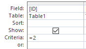
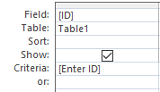
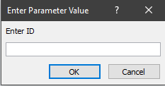

## Static and dynamic parameters

  - **Static parameters-** Used in the queries mentioned so far. The
    parameter values will not change each time the query is run.  
    

  - **Dynamic parameters-** Used when the parameter values can be chosen
    every time the query is run, and so the values are never fixed.  
      
      
    
