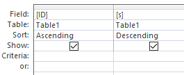
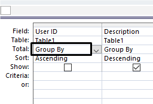

## Sort Data

  - **Ascending/descending-** Data can be stored in either ascending or
    descending order within a table, query or report. ‎  
    

  - **Grouped-** More than one field can be used to create the sort.  
    
