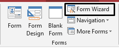
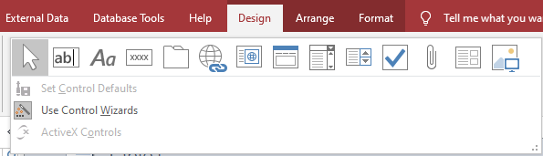

## ‎Data entry form

  - Used for entering data. Multiple factors are to be considered when
    making an effect and user-friendly data form.  
    
    
      - **Appropriate font styles and sizes-** The text in the form must
        be easy to read, be an appropriate colour and must have a
        consistent font style
    
      - **Spacing between fields-** There must be appropriate spacing
        between each field so the data and clear and distinguishable
    
      - **Character spacing of individual fields-** There must be
        sufficient space between each character within the data to be
        viewed properly
    
      - **Use white space-** Used to separate data and prevent screen
        from looking like a mess
    
      - **Navigation buttons-** To allow uses to navigate between
        records
    
      - **Radio boxes-**To allow users to select one mutually exclusive
        option
    
      - **Check boxes-** Used to select items
    
      - **Drop-down menus**- To allows users to select from a set of
        options
    
      - **Highlight key fields-** Important fields should be highlighted

