## Video editing

  - Importing files and inserting
    image(s)/video(s)  
    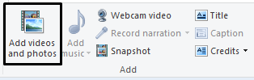

  - Setting aspect ratio  
    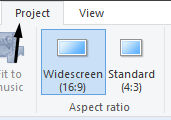

  - Trimming video clips and joining them
    together  
    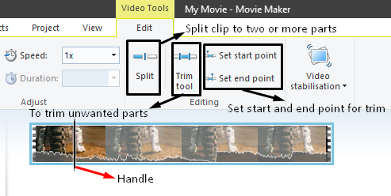  
      
    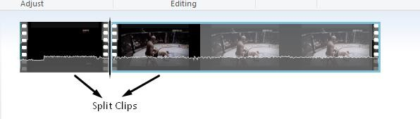

  - Text based slides and credits  
    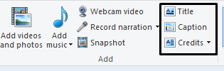  
      
    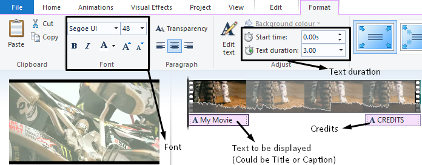

  - Animation and effect  
    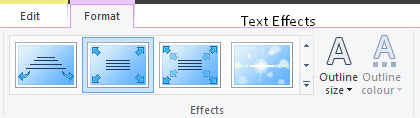  
      
    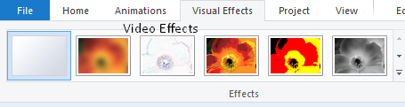

  - Extracting a still image (snapshot)  
    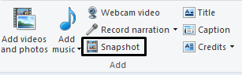

  - Adding sound file  
    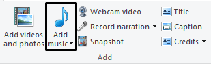

  - Video clip speed  
    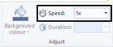

  - Resolution (custom resolution)  
    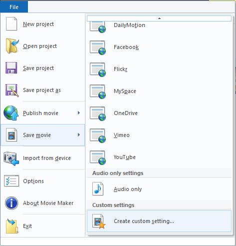  
      
    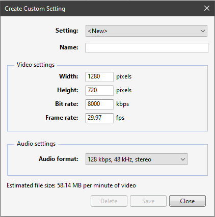

  - Exporting
    
      - Most websites use .mp4, .avi, .mpv for videos.

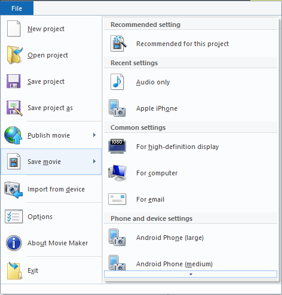
