## Sound editing

  - Trimming and joining audio clips  
    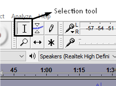  
      
    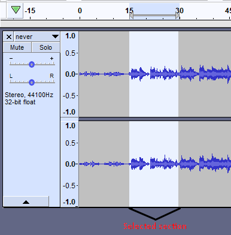  
      
    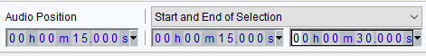

^ A more accurate way of splitting and trimming audio clips

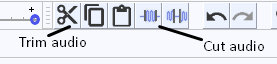

  - Fade in and out  
    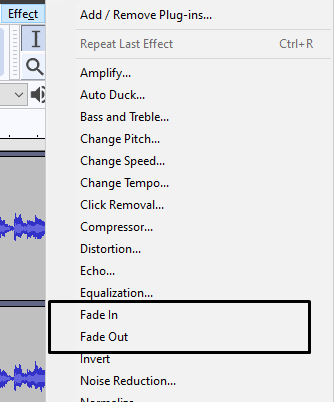

| Fade in                                                                          | Fade out                                                                         |
| -------------------------------------------------------------------------------- | -------------------------------------------------------------------------------- |
| 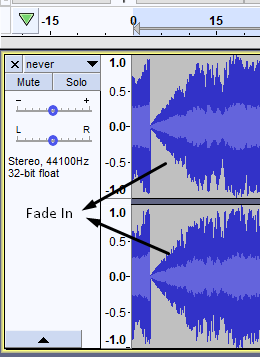 | 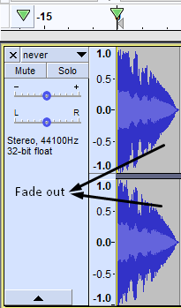 |

  - Altering the speed and pitch of a sound
    clip  
    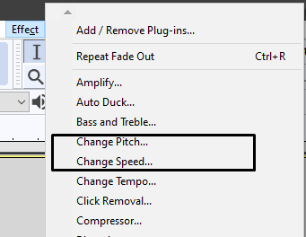  
      
    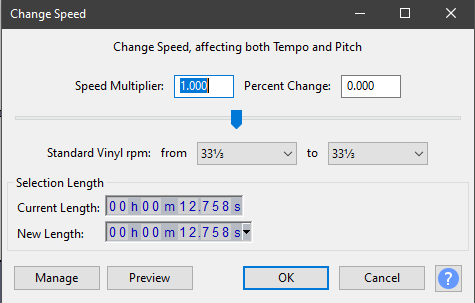
    
      - Changing the speed of an audio clip also changes the pitch of
        the clip  
        

  - Reverberation (Reverb)  
    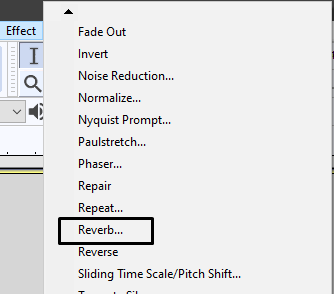  
      
    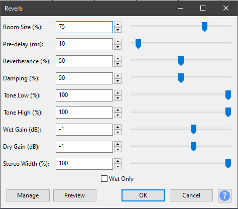

  - **Exporting-** The most commonly used
    format for audio clips are .mp3, and during exporting, sample rates
    can also be changed.  
    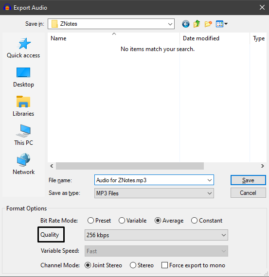