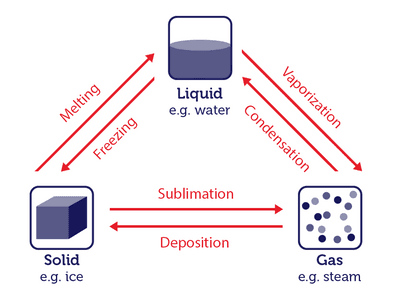

# **WATER**

## Particle Theory

* Atoms is the smallest particle found in everything

### Atomic Movement

* According to the kinetic particle theory, all matter is a collection of particles that are in constant, random motion

* even if those movements are only small vibrations

* These movements are determined by the amount of energy it has

### States of Matter

* Matter exists in 3 stages of solid, liquid, & gas

* The state of matter changes as their energy changes

* Example:

  * As water cools down, its particles slow down & they arrange in a regular structure (lattice), creating ice crystals

  * Then when water heats up over its boiling point, its particles move erratically, breaking the forces holding them together and rapidly evaporates

  * Sometimes even during stable temperature, the water molecules can collide due to each atom being closely packed together (but able to move freely past each other), sending off some of the surface atoms

### More About Atoms

* Atom is made up of 3 subatomic particles that are:

#|
||

‎

|

Protons

|

Neutrons

|

Electrons

||
||

Charge

|

\+1

|

0

|

\-1

||
||

Mass

|

1

|

1

|

1/1800

||
|#

* Neutrons and protons are located in the nucleus

* Electrons orbits around it in the shells

  * The first shell only accommodates up to 2 electrons

  * the second and more shells can accommodate 8 electrons

  * When the shell is full, the atom is stable, this condition is called valent.

* Different elements contain different numbers of protons, this proton number is called Atomic number