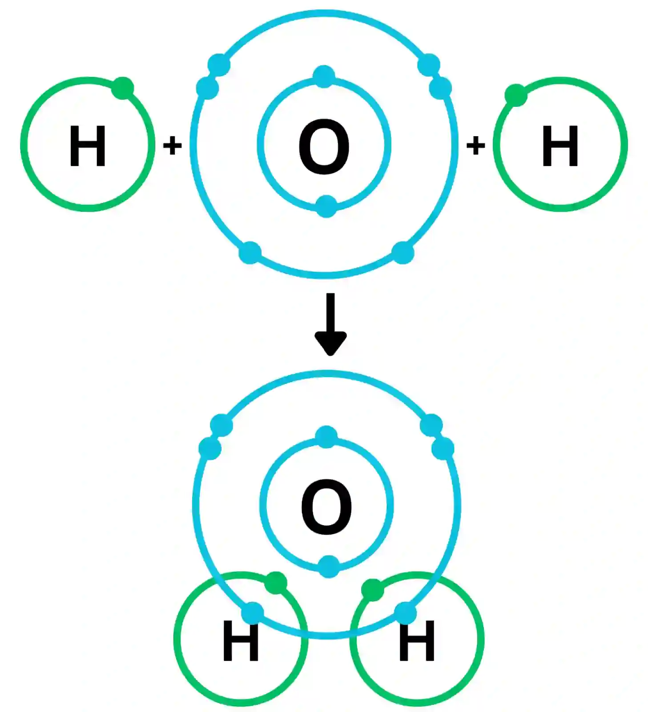
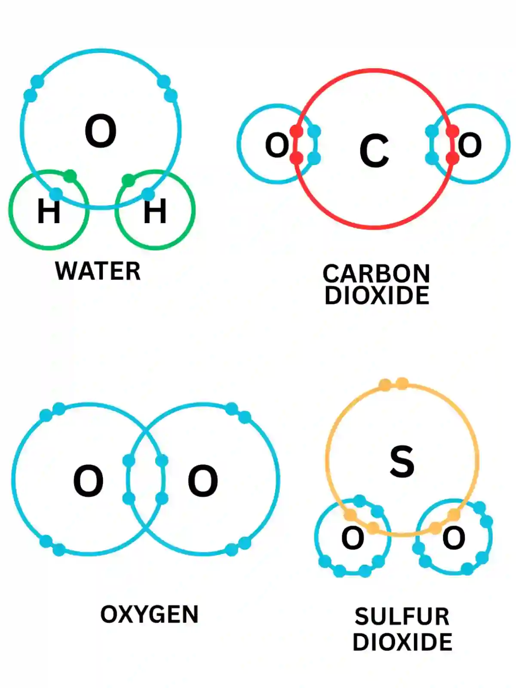
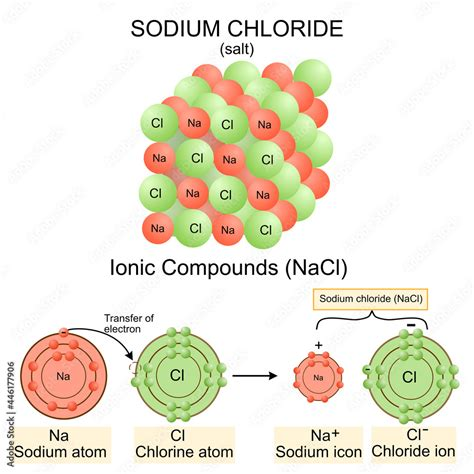

## Bonding

* Bonding happens when individual atoms come together to form different substances

* With a specific ratio of different elements bonded together

* creating a compound with new characteristics that can be called as emergent properties

### **Covalent Bonds**

* Covalent bond is the sharing of a pair of electrons which occurs between non-metals

* By sharing the electron pairs between atoms, they will have complete outer shells

* This bond is one of the strongest bonds, requiring a lot of energy to break

* Water is one of the most prevalent covalent compound

  * Water is formed when an oxygen atom, which only has six electrons in its outermost shell reacts with two hydrogen atoms, with one electron each.

  * The hydrogen atom shares their individual electrons with the oxygen atom.

  * The shared electrons orbit around the atoms connected in the bond, filling the outer shells of the oxygen and hydrogen.

* Glucose is a covalently bonded molecule produced through photosynthesis

  * Glucose is a carbohydrate

  * It is important because a lot of energy is stored in the covalent bonds, making glucose a useful molecule to hold chemical energy

  * In environments where photosynthesis is not possible, some bacteria use chemosynthesis to break apart covalent bonds within the molecule sulfur dioxide in order to obtain energy for survival

* Compounds such as carbon dioxide and sulfur dioxide are also covalently bonded.

### **Ionic Bonds**

* Ion is a charged atom that has gained (-) or lost (\+) an electron,

* an electron will move from an atom to fill or empty outer electron shells.

  * It is formed when an ion loses an electron, its positive charge is attracted to the newly formed negative ion that gained its electron.

  * This electrostatic attraction causes an ionic bond to form.

* Sodium chloride is a salt that is ionically bonded where its atoms, sodium and chlorine, have incomplete outer shells

  * Sodium has a single electron and chlorine has seven electrons

  * So sodium’s single electron breaks away and moves to complete chlorine’s outer shell, making a stable sodium ion aqnd chloride ion

  * Sodium ion has a positive charge while chloride ion has a negative charge

  * Then the electrostatic attraction between the positive sodium ions and the negative chloride ions creates an ionic bond.

  * The result of these ionic bonds usually create solids that have a three dimensional ionic lattice structure.

* Other salts found in the ocean include calcium carbonate (CaCO3) and magnesium sulfate (MgSO4).

### **Hydrogen Bonds**

* Hydrogen bond is a weaker bonds that occur between molecules containing a hydrogen atom bonded to an atom of oxygen, nitrogen, or fluorine

* When creating covalent bonds, such as water, the oxygen and hydrogen atoms share electrons unequally

* the oxygen atom has a much stronger attraction to the bonding pair of electrons between oxygen and hydrogen

* resulting in these being pulled closer to the atom than the hydrogen

* further causing hydrogen to be partially positive while oxygen is partially negative

* These molecules are polar molecules, usually called dipoles

  * dipole is a molecule with a separation of partial positive and negative charges
  * 

* While hydrogen bonds are easily broken, it is continually formed between water molecules as there are many water molecules in a single droplet

  * Hydrogen bonding gives water the great property of being a solvent, a material capable of dissolving other substances
  * Due to the partial changes on the water, allowing molecule’s charged ions to interact with water partial ions

* The density of water is also impacted by hydrogen bonds because as matter cools down, they lose energy, which then allows them to slow their movement and gather closely, strengthening hydrogen bonds.

  * The hydrogen bonds then help keep the water molecules at perfectly symmetrical distances from each other, forming crystal lattice-like shape which spreads the molecules out further than they were, causing the density to be lessened.

* The specific heat capacity (the amount of heat  required to change 1 kg of mass by one degree celsius) of water is one of the highest due to the number of hydrogen bonds within it, creating a temperature buffer, helping to moderate our planet’s climate.