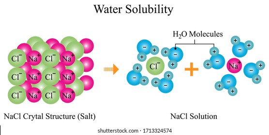

## Solubility in Water

* Solvent dissolves a substance called solute

* when solute and solvent mixes, it creates a solution

* Solubility is the extent to which a particular solute, such as sodium chloride, can be dissolved in a solvent, such as water

* The process of creating solutes is called dissolution

* Water is a good solvent due to it being polar, thus able to interact with ions from ionic substances

### NaCl in Water

* When in water, the sodium chloride ions are easily dissolved when their bonds are broken by the water molecules.

* At this point, the partially (\+) hydrogen ends of water molecules will surround the (-)ly charged chloride ions,

* and the partially (-) oxygen ends of water will surround the (\+)ly charged sodium ions.

### **Impacts on Solubility**

* As the temperature of seawater rises, the rate of dissolution of salts increases as well

* because as water heats up, the individual water molecules move faster,

* This movement helps mix the ions and break the ionic bonds, further surrounding each charged ion with water molecules.